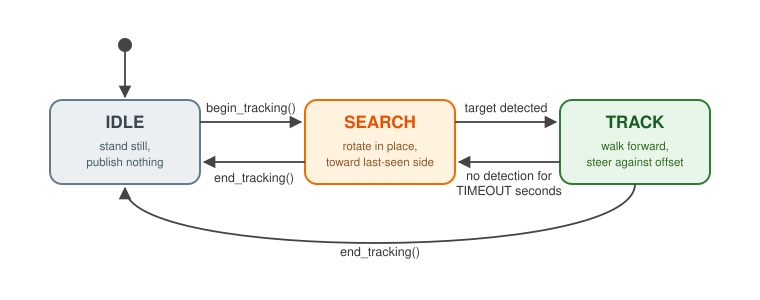
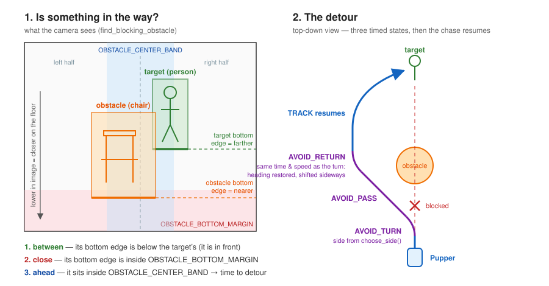

Lab 5: Follow Me Pupper
========================

*Goal: give Pupper eyes — detect objects onboard, follow a person with a state
machine, stay on that one person, and stop at a polite distance.*

.. TODO(staff): add this offering's lab slides link
.. TODO(staff): add this offering's lab document link
.. TODO(staff): capture a detour sequence figure on a robot. Old Foxglove
   screenshots no longer apply.

`Lab slides <#>`_ (TODO)

`Lab document <#>`_ (TODO)

Everything in this lab runs *on the robot*: YOLOv8n-seg on Pupper's Hailo AI
accelerator turns camera frames into detections, your state machine turns
detections into motion, and a browser viewer shows you what Pupper sees while
it happens. No API keys, no cloud, no voice — the tracking API you build here
(``begin_tracking()`` / ``end_tracking()``) is exactly the kind of skill the
robot foundation model lab will drive with language later in the quarter.

The intellectual core of the lab is a single, lovely idea: **your robot's
camera has no depth sensor, and yet it can tell how far away things are** —
because everything stands on the same floor, and the floor recedes upward in
the image. The bottom edge of a bounding box *is* a distance sensor. You will
use it to stop at a polite distance.

The lab builds one robot in three steps: first it **follows** a person (Step
2), then it follows **you** specifically, by tracking the person nearest to
where you just were (Step 3), then it stops at a **polite distance** (Step 4).
Two optional steps go further: telling people apart by the color of their
clothes (Step 5), and stepping around **something in the way** (Step 6). Both
are built from simple heuristics, and both are fragile on the real robot — do
them if you are curious; the follower works without them.

.. admonition:: AI Use Suggestion
   :class: note

   **This lab is designed to be completed without a coding agent.** Every
   TODO is a few lines, and the desk-side tests tell you exactly what each one
   must do. That said, you are free to use a coding agent (Claude Code or
   Codex) for the coding part, on two conditions:

   * **Understand the high-level ideas** — why the bottom edge of a box is a
     distance sensor, how the state machine moves between states, and how
     the target lock stays on one person — well enough to explain them
     without your agent open.
   * **Understand every line your agent writes**: what it does and why it is
     there. If you cannot explain a line, ask the agent to explain it until
     you can.

   Answer every DELIVERABLE in your own words, from what you did and saw on
   your robot.

   .. important::

      **Quiz 2 tests this.** Some implementation details of this lab — what a
      function returns, why a check is written the way it is, what the robot
      does when a check is missing — will be on Quiz 2.

.. list-table:: Lab roadmap
   :header-rows: 1
   :widths: 10 50 40

   * - Step
     - What you do
     - Code and tests
   * - 0
     - **Setup:** fork, clone, download the model
     - (reading)
   * - 1
     - **See:** run the camera, detector and viewer
     - (nothing to write)
   * - 2
     - **Follow:** the state machine, following the most centred person
     - ``lab/boxes.py``, ``lab/follow_me.py`` · ``lab/test.py step2``
   * - 3
     - **Follow me, specifically:** stay on *your* person, the one nearest
       to where they just were
     - ``lab/target_lock.py``, an edit in ``lab/follow_me.py`` ·
       ``lab/test.py step3``
   * - 4
     - **Follow me, at a polite distance:** the bottom edge of the box as a
       distance sensor
     - ``lab/boxes.py``, ``lab/target_lock.py``, two edits in
       ``lab/follow_me.py`` · ``lab/test.py step4``
   * - 5 *(optional)*
     - **Follow me, very specifically:** tell people apart by the color of
       their clothes
     - ``lab/target_lock.py`` · ``lab/test.py step5``
   * - 6 *(optional)*
     - **Something in the way:** decide when something blocks the path (the
       detour is provided)
     - ``lab/avoidance.py``, ``lab/follow_me.py`` · ``lab/test.py step6``

**The tests: what they check.** ``python3 lab/test.py`` runs your code on
fake detections — no robot, no ROS needed. Give it a step
(``python3 lab/test.py step2``) to test just that step; with no step, it runs
the required Steps 2–4 (the optional ones run only when you name them:
``python3 lab/test.py step5``). A check whose code you have not written yet is skipped (``--``),
not failed, so run it after every function. A failing check prints what your
code returned, what was wanted, and an example that passes. Each step below
ends with a table of *every* check: nothing is checked that is not in the
table. The tests check what your code returns, not how it is written; the
robot is the test of how well it all works together.

Step 0. Setup
^^^^^^^^^^^^^^^^^^^^^^^^^^^^^^^^^^^^^^^^^^^^^
1. Fork the `follow_me_pupper <https://github.com/cs123-stanford/follow_me_pupper>`_
   repository to your own GitHub account, following
   :doc:`forking_repositories`.

2. Clone your fork onto the Pupper and fetch the detection model:

.. code-block:: bash

   cd ~/
   git clone https://github.com/YOUR_USERNAME/follow_me_pupper.git
   cd follow_me_pupper
   ./scripts/download_model.sh      # robot/yolov8n_seg.hef, ~11 MB

3. Skim the README — especially the "How the pieces talk" diagram. Everything
   you write is in ``lab/``: ``follow_me.py``, ``boxes.py``,
   ``target_lock.py``, ``avoidance.py`` (optional), and the desk tests for
   them. ``robot/`` is provided
   (camera, detector, viewer, launch file, Karel API): read it, don't rewrite
   it. Run every command from the repo root. Three programs cooperate over ROS
   topics: ``robot/viser_camera.py`` (camera → YOLO → ``/detections``),
   ``lab/follow_me.py`` (your state machine, ``/detections`` →
   ``/cmd_vel``), and ``robot/karel.py`` (the API that switches tracking on
   and off over ``/tracking_control``).

   Every function you write has a card at the end of its docstring: what each
   input is, what it should return (with an example), what calls it, and the
   test to run.

Step 1. See What Pupper Sees
^^^^^^^^^^^^^^^^^^^^^^^^^^^^^^^^^^^^^^^^^^^^^
The camera stack and viewer are given — get them running before writing any
code.

1. Launch the robot stack (motors, camera, detector, viewer):

.. code-block:: bash

   ros2 launch robot/follow_me.launch.py

2. Open the viewer. On the same Wi-Fi, browse to ``http://<pupper-ip>:8080``.
   Over SSH, forward the port from your laptop first and browse to
   ``localhost:8080``:

.. code-block:: bash

   ssh -N -L 8080:localhost:8080 pi@pupper[YOUR_GROUP_NUMBER].local

3. You should see the camera feed with bounding boxes *and* segmentation
   masks around detected objects — 80 COCO classes' worth. Two GUI settings
   matter when the Wi-Fi is weak: **Lock aspect ratio** and **Drop frames
   when behind** (both on by default; the README explains what each does).

   .. figure:: ../../../_static/lab5/pupper_viser.png
      :align: center

      The viser viewer on the equirectangular view: a person, a chair, a TV
      and a bed, each with a bounding box, confidence score, and
      segmentation mask.

4. Notice the **View** dropdown: the raw image is a fisheye, but detection
   always runs on the *equirectangular* (undistorted) view. The fisheye lens
   bends people into shapes YOLO has never seen — scores drop badly on the
   raw image. ``robot/fisheye_converter.py`` holds the math if you are curious
   (totally optional).

**DELIVERABLE:** A screenshot of the viewer showing detections with bounding
boxes and masks. Upload to Gradescope.

**DELIVERABLE:** In a sentence or two: why do we run the detector on the
undistorted image instead of the raw fisheye?

Step 2. Follow
^^^^^^^^^^^^^^^^^^^^^^^^^^^^^^^^^^^^^^^^^^^^^
First, a robot that follows *a* person: turn toward the most centred one, walk
at a constant speed, and spin to look for them when they disappear. All of it
is in ``lab/follow_me.py``, plus one helper in ``lab/boxes.py``.

``follow_me.py`` is a ROS 2 node with a state machine. The ROS plumbing is
provided: ``detection_callback`` runs about ten times a second with every
detection in the frame, and ``timer_callback`` runs every 0.1 s and publishes
a velocity command. Each calls small methods that you write; each method has
a card in its docstring with its inputs, what it returns, and an example. The
states:

- **IDLE** — tracking off; stand still (and stay quiet on ``/cmd_vel``, so
  manual Karel commands still work). Provided.
- **SEARCH** — target lost; rotate to find it.
- **TRACK** — target in view; steer toward it and walk.

   The core tracking state machine. Every arrow is a condition; every box is
   a motion command.

Write, in order:

1. ``box_offset`` in ``boxes.py``: how far off-centre a box is, from −0.5
   (left edge) to +0.5 (right edge). Read the "What a detection looks like"
   section at the top of ``boxes.py`` first. The
   `message documentation <http://docs.ros.org/en/kinetic/api/vision_msgs/html/msg/Detection2DArray.html>`_
   has the full structure.
2. ``process_detections``: keep the detections of the class you are
   tracking, take the most centred one, and remember its offset and the time
   you saw it. Return it (or ``None`` if there is none).
3. ``choose_state``: TRACK if the target was seen within ``TIMEOUT`` seconds,
   else SEARCH.
4. ``motion_command``: what to do in each state, as ``(yaw, forward)``.
   TRACK is a proportional controller: steer against the offset with gain
   ``KP``, and walk at ``TRACK_FORWARD_VEL``. SEARCH spins in place — toward
   the side where the target was last seen.
5. The constants at the top of ``follow_me.py``: ``TIMEOUT``,
   ``SEARCH_YAW_VEL``, ``TRACK_FORWARD_VEL``, ``KP``. Start with
   ``1.0, 1.0, 0.3, 5.0`` and tune on the robot. ``TRACK_FORWARD_VEL`` is how
   fast Pupper walks; from about 0.5 m/s up, the walking policy switches from
   a trot to a gallop — that is when it runs. Start slow.

Run ``python3 lab/test.py step2`` after each one. Then try it on the robot,
in two more terminals:

.. code-block:: bash

   python3 lab/follow_me.py             # terminal 2: your state machine
   python3 robot/test_tracking.py       # terminal 3: choose what to track

(or start tracking immediately with
``python3 lab/follow_me.py --ros-args -p target:=person``; the ``KarelPupper``
API — ``begin_tracking("person")``, ``end_tracking()`` — is what
``robot/test_tracking.py`` uses under the hood, and the shape of the follow
tool the foundation-model lab will give a language model.
``scripts/run_tracking.sh`` runs all three terminals at once for quick demos.)

.. note::

   **Debugging with pdb**: add ``breakpoint()`` inside ``process_detections``
   and run ``python3 lab/follow_me.py`` to inspect what is actually arriving:
   what does ``detections`` contain? Is ``self.target_pos`` sensible? (``p
   variable`` prints, ``n`` steps, ``c`` continues.)

**What** ``python3 lab/test.py step2`` **checks.** The fake ``self`` has just
the fields your methods read, and a clock.

.. list-table::
   :header-rows: 1
   :widths: 36 34 30

   * - Check
     - Passes
     - Fails
   * - ``box_offset`` of a centred box is 0, and of a box at the right edge
       about +0.49
     - centre x=690 of 700 gives ``690 / 700 - 0.5 = 0.486``
     - ``0.986`` (forgot the ``- 0.5``), or ``340`` (not normalized)
   * - ``choose_state``: seen within ``TIMEOUT`` → TRACK; not seen for
       longer, or never → SEARCH
     - ``State.TRACK`` / ``State.SEARCH``
     - SEARCH while the target is in view (the comparison flipped)
   * - ``process_detections`` returns the most centred *person*, even with a
       chair closer to the centre
     - the person at x=370, not the one at x=200 or the chair
     - the chair (the class is not checked)
   * - ... stores its offset in ``self.target_pos`` and the time in
       ``self.last_detection_time``
     - ``0.029`` and ``self.get_clock().now()``
     - the pixel x ``370``
   * - ... returns ``None`` for a frame with no person, or no detections
     - ``None``
     - a crash on ``min`` of an empty list
   * - ``motion_command`` SEARCH: turn in place toward where the target was
       last seen, and still turn when it was never seen
     - last seen on the right (``+0.2``): ``(-SEARCH_YAW_VEL, 0.0)``
     - ``(+SEARCH_YAW_VEL, 0.0)`` (the signs: + yaw turns *left*), or
       ``0.0`` yaw before the first sighting
   * - ``motion_command`` TRACK: ``-KP * offset`` and ``TRACK_FORWARD_VEL``
     - offset ``+0.1`` gives yaw ``-0.5`` with ``KP = 5``
     - ``+0.5`` (steering away from the target)

**DELIVERABLE:** A video of Pupper following a person, showing both search
and track behavior. Upload to Gradescope.

**DELIVERABLE:** A video with *two* people in frame. Which one does your
robot follow, and why? And what happens when you walk right up to it?
(Notice anything unsatisfying? Hold that thought for Steps 3 and 4.)

Step 3. Follow Me, Specifically
^^^^^^^^^^^^^^^^^^^^^^^^^^^^^^^^^^^^^^^^^^^^^
Your Step 2 videos showed two problems. This step fixes the first: "most
centred" happily hops between people. To YOLO every person is just class
``person``, so the moment a second person walks closer to the middle of the
frame, the robot switches to them.

**Where were they a moment ago?** Detections arrive about ten times a second,
and nobody teleports between frames: in 0.1 s a person barely moves in the
image. That is the same small-motion assumption optical flow is built on — the
thing you are tracking is close to where it just was. So the person nearest to
where your target was last frame is almost certainly your target. And if
nobody is near that spot, your target is gone: the robot should go looking for
them, not chase whoever is left.

All of it is in ``lab/target_lock.py``, which keeps a small ``Lock``: where the
target was last frame (``lock.position``, as the box's offset and centre
height, both fractions of the image).

1. ``position_distance``: how far a detection is from a remembered position,
   in fractions of the image.
2. ``pick_target``: two rules, in order — with no position remembered (a new
   chase), the most centred person, as in Step 2; otherwise, of the people
   within ``LOCK_GATE`` of where the target was, the nearest. Nobody that
   close: ``None``.
3. ``remember``: after each choice, store where the target is now.

**Wire it in.** One edit to your Step 2 code in ``follow_me.py`` (its stub
says exactly where): ``process_detections`` uses
``target_lock.pick_target`` instead of "most centred", returns ``None`` when
it does, and otherwise calls ``remember``. When the robot loses you and
starts to spin, the provided code forgets where you were: that spot means
nothing once it turns.

Run ``python3 lab/test.py step3`` until every check passes.

**What** ``python3 lab/test.py step3`` **checks.** People are 120 × 300 px
boxes; ``LOCK_GATE`` is 0.12. Distances pass within ±0.005.

.. list-table::
   :header-rows: 1
   :widths: 36 34 30

   * - Check
     - Passes
     - Fails
   * - ``position_distance`` is 0 to a detection's own position, and in image
       fractions (70 px sideways = 0.1)
     - ``0.1``
     - ``70.0`` (pixels, not fractions of the image)
   * - ``remember`` stores the position
     - ``lock.position == box_position(detection)``
     - ``lock.position`` still ``None``
   * - ``pick_target``, new chase: the most centred person
     - the person at x=370, not the one at x=200
     - the first in the list
   * - ... the target was at x=500 and moved to x=530; a bystander stands at
       x=370: nearest to where the target was wins
     - the person at x=530
     - the bystander (still "most centred")
   * - ... nobody within ``LOCK_GATE`` of where the target was
     - ``None``
     - the far-off person (a bystander takes over)
   * - ... of two people near where the target was, the nearer
     - the person 10 px away, not the one 40 px away
     - the first one found inside the gate
   * - ... after a search (no position remembered): the most centred person
       again
     - the person at x=380
     - ``None``, or a crash on ``lock.position`` being ``None``
   * - Wired in: ``process_detections`` returns ``None`` when the only person
       is far from where the target was, and calls ``remember``
     - ``None``; the lock holds the target's position
     - the far-off person (still "most centred")

**DELIVERABLE:** In your own words: what assumption lets "nearest to where it
just was" find the same person in the next frame? What does the robot do when
nobody is near that spot, and why is that better than following whoever is
left?

**DELIVERABLE:** A video: Pupper follows you while a second person walks
through the frame, and it stays on you. Then break it on purpose: find a
situation where your lock *must* jump to the wrong person (hint: what happens
when you cross paths, or when the robot loses you and searches?), show it
failing, and explain why that failure is exactly what your algorithm
predicts.

Step 4. Follow Me, at a Polite Distance
^^^^^^^^^^^^^^^^^^^^^^^^^^^^^^^^^^^^^^^^^^^^^
The second problem from Step 2: the robot walks straight into your shins.

**How close? The bottom edge of a box is a distance sensor.** The camera has
no depth. But everything stands on the same floor, and the floor recedes
*upward* in the image: the further away something is, the higher its point of
contact with the ground appears. So the lower a box's bottom edge sits in the
image, the closer the object is.

1. ``box_bottom`` in ``boxes.py``: the y of a box's bottom edge.
2. Measure where Pupper should stop:

   a. With the launch running, open the viewer and stand in front of Pupper
      at the distance you want it to keep (close, but not on top of it —
      your feet should still be in frame).
   b. Save the **Live feed** image from the viewer's side panel (it is the
      equirectangular frame the detector sees, without padding).
   c. In the image, find the y of your box's bottom edge, in pixels, and
      scale it to the 572 px reference frame:
      ``STOP_BOTTOM = y_bottom / image_height * 572``. Put it into
      ``target_lock.py``.

3. ``approach_speed``: a proportional controller on the error to
   ``STOP_BOTTOM``. Further than ``SLOWDOWN_PX`` short of it, walk at the top
   speed (``TRACK_FORWARD_VEL``); closer, slow down in proportion to the
   error, ``max_forward * error / SLOWDOWN_PX``; stand still inside
   ``STOP_TOLERANCE``; step back (no faster than ``MAX_BACKUP_VEL``) when
   they come too close.

**Wire it in.** Two small edits in ``follow_me.py`` (their stubs say exactly
where): ``process_detections`` also stores ``self.target_bottom``, and
``motion_command`` walks at ``approach_speed`` instead of a constant speed in
TRACK.

.. tip::

   **Want it to run?** Raise ``TRACK_FORWARD_VEL``: the whole approach
   speeds up with it, and from about 0.5 m/s Pupper gallops. If a fast
   Pupper overshoots and bumps into you, raise ``SLOWDOWN_PX`` so it starts
   braking earlier.

Run ``python3 lab/test.py step4`` until every check passes.

**What** ``python3 lab/test.py step4`` **checks.** Speeds use
``SLOWDOWN_PX = 120``, ``STOP_TOLERANCE = 15``, ``MAX_BACKUP_VEL = 0.2`` and a
top speed of 0.3 m/s unless noted, and pass within ±0.01 m/s.

.. list-table::
   :header-rows: 1
   :widths: 36 34 30

   * - Check
     - Passes
     - Fails
   * - ``box_bottom`` is the bottom edge
     - a box from y=200 to y=500 gives ``500``
     - ``350`` (the centre), or ``200`` (the top: image y grows *downward*)
   * - ``STOP_BOTTOM`` is measured: a bottom edge inside the 572 px frame
     - the value you measured from your Live feed image, between 0 and 572
     - ``None`` (skipped until you measure it), or the raw pixel y from a
       screenshot of a different height, not scaled to 572
   * - ``approach_speed`` at ``STOP_BOTTOM``, and halfway to the edge of
       ``STOP_TOLERANCE``: stand still
     - ``0.0``
     - a tiny speed like ``0.02`` (no dead band: Pupper shuffles in place)
   * - ... far away: walk in at the top speed
     - 200 px short gives ``0.3`` (0.3 × 200 / 120 = 0.5, capped)
     - ``0.5`` (not capped at ``max_forward``)
   * - ... a little far: proportional, ``max_forward * error / SLOWDOWN_PX``
     - 40 px short gives ``0.1``
     - ``0.3`` (full speed whenever it is far)
   * - ... scales with the top speed: twice ``max_forward``, twice as fast
     - 40 px short at ``max_forward`` 0.6 gives ``0.2``
     - ``0.1`` (a fixed gain in m/s per pixel: raising ``TRACK_FORWARD_VEL``
       would only change the cap, never the speed you actually walk at)
   * - ... too close: back away, no faster than ``MAX_BACKUP_VEL``
     - 30 px past gives ``-0.075``; 200 px past gives ``-0.2``
     - ``0.0`` or positive (the sign flipped), or ``-0.5`` (not clamped)
   * - Wired in: ``process_detections`` stores ``self.target_bottom``
     - ``400``
     - ``0.0`` (never set)
   * - Wired in: ``motion_command`` TRACK at ``STOP_BOTTOM`` stands still
     - forward ``0.0``
     - ``TRACK_FORWARD_VEL`` (still a constant speed)

**DELIVERABLE:** Explain the distance-from-bottom-edge trick in your own
words: *why* does a lower bottom edge mean a nearer object? Then give two
concrete situations where this assumption lies to the robot, and what it
would do wrong in each.

**DELIVERABLE:** The Live feed image you measured ``STOP_BOTTOM`` from, and
the value you got.

**DELIVERABLE:** ``approach_speed`` reaches the top speed at a fixed pixel
error (``SLOWDOWN_PX``), so its gain is ``max_forward / SLOWDOWN_PX``. Suppose
it used a fixed gain instead, say 1.5 m/s per full image height of error,
capped at ``max_forward``. You raise ``TRACK_FORWARD_VEL`` from 0.3 to 1.0
m/s: how fast does Pupper approach someone whose bottom edge is 100 px short
of ``STOP_BOTTOM``, in each version? Why does a person far away produce only
a small pixel error in the first place?

**DELIVERABLE:** A video: Pupper follows you, stops at the right distance,
and backs off when you step toward it.

Step 5 (Optional). Follow Me, Very Specifically
^^^^^^^^^^^^^^^^^^^^^^^^^^^^^^^^^^^^^^^^^^^^^^^^
Step 3's lock forgets you the moment the robot has to search: when it finds a
person again, it takes the most centred one, whoever that is. And when two
people cross paths, "nearest to where they were" can jump to the wrong one.
A second cue can help.

**What do they look like?** The segmentation mask says which pixels *are* the
person — mostly their clothes — and every detection ships the **mean color of
its mask** in the message's ``id`` field, as ``"r,g,b"``. A person whose
color is far from your target's is a stranger, wherever they stand; and when
your target vanishes and reappears somewhere else, the color finds them
again.

.. warning::

   On the real robot, this works less well than it sounds. The mean color of
   a mask shifts with lighting, with how much of the person is in frame, and
   with the background pixels a mask lets in; two people in dark clothes look
   alike. That is why it is optional, and why Gemini Pupper's follow mode
   (Lab 6) leaves it off.

All of it is in ``lab/target_lock.py``:

1. ``color_distance``: the RGB distance between a detection's color and the
   remembered one — or ``None`` when either is missing.
2. ``pick_target_by_color``: three rules, in order — a new chase takes the
   most centred person; otherwise the nearest non-stranger close to where
   the target was; otherwise the best color match, if it is close enough. A
   frame of only strangers has *no* target: the robot searches for its own
   person instead of chasing whoever is left.
3. ``remember_color``: after each choice, blend the target's color into the
   remembered one, so the memory follows slow lighting changes.
4. Switch it on: ``USE_COLOR = True`` at the top of ``target_lock.py``. Then
   ``pick_target`` and ``remember`` call your new functions. When the robot
   loses you and starts to spin, it still forgets where you were — but not
   your color.

**What** ``python3 lab/test.py step5`` **checks.** The people wear red
(200, 40, 40), blue (40, 60, 200), or "reddish" (185, 55, 50): the red shirt
under slightly different light. In the ``pick_target_by_color`` checks, the
lock was just following a red person at the centre of the frame, bottom edge
at y=400. Colors pass within ±1 (on the 0–255 scale).

.. list-table::
   :header-rows: 1
   :widths: 36 34 30

   * - Check
     - Passes
     - Fails
   * - ``color_distance`` of the same shirt is 0; with no color on the
       detection, or nothing remembered, it is ``None``
     - ``None`` for ``id == ""``
     - ``0.0`` or a crash when a color is missing (missing is *no evidence*,
       not a perfect match)
   * - ``remember_color`` on first sight stores the color
     - ``lock.color == [200, 40, 40]``
     - ``lock.color`` still ``None``
   * - ``remember_color`` after that blends the color by ``REID_BLEND``
     - 0.9 × red + 0.1 × reddish = ``[198.5, 41.5, 41]``
     - ``[185, 55, 50]`` (replaced, not blended), or the weights swapped
   * - ``pick_target_by_color``, new chase: the most centred person
     - the person at x=370, not the one at x=200
     - the first in the list
   * - ... nearest to the last position wins, even over a better color far
       away
     - the reddish person 15 px from where we were
     - the red person at x=100 (color checked before position)
   * - ... a stranger alone in our spot: no target
     - ``None`` (blue is too far from red)
     - the stranger (position trusted without the color check)
   * - ... two people crossing, the nearer one a stranger: ours wins
     - the reddish one
     - the blue one (strangers not left out of "nearby")
   * - ... a stranger in our spot and us elsewhere: re-acquire us by color
     - the reddish person at x=120
     - ``None`` (gave up instead of trying rule 3)
   * - ... after a search (no position remembered): re-acquire by color
       anywhere
     - the reddish person at x=600
     - the blue one at x=300 (most centred)
   * - ... with no masks (no colors at all): nearest position decides
     - the person 10 px away, not the one 40 px away
     - ``None`` (a missing color treated as a stranger)

**OPTIONAL DELIVERABLE:** In your own words: how do position and the mask
color together tell one person from another when bounding boxes alone
cannot? What stops a frame containing only strangers from stealing the lock?

**OPTIONAL DELIVERABLE:** A video: the Step 3 failure you found, now with
color on. Does it hold? Then find a situation where color fails too, and
explain why.

Step 6 (Optional). Something in the Way
^^^^^^^^^^^^^^^^^^^^^^^^^^^^^^^^^^^^^^^^^^^^^
Put a chair between Pupper and the person: TRACK walks straight into it,
because nothing it computes knows the chair exists. Obstacle avoidance is
built out of the same bottom-edge trick, and most of it is provided — you
write the two decisions at its heart, and read the rest.

.. warning::

   Let's be frank: this obstacle avoidance is not very good. It is a stack of
   hand-tuned heuristics, and on the real robot it will often miss an
   obstacle, detour around nothing, or pick the wrong side. That is why it is
   optional, and why Gemini Pupper's follow mode (Lab 6) leaves it off.

   Obstacle avoidance from one observation: bottom edge = distance. An
   obstacle *blocks* when it passes all three tests on the left; the robot
   then sidesteps it with three timed states and resumes the chase.

1. ``find_blocking_obstacle`` in ``avoidance.py``: is something actually
   *in the way*? Three tests: between us and the target (bottom edge below
   the target's), close (within ``OBSTACLE_BOTTOM_MARGIN`` of the image
   bottom), and roughly ahead (inside ``OBSTACLE_CENTER_BAND``). The nearest
   one that passes all three wins.
2. ``ready_to_avoid`` in ``follow_me.py``: should a detour start *now*? Only
   when something blocks, when we are walking toward the target (at the stop
   distance a detour would walk into them), and not right after the last
   detour (the cooldown).
3. Switch it on: ``ENABLE_OBSTACLE_AVOIDANCE = True`` at the top of
   ``follow_me.py``.

**Read the rest** (provided): ``measure_crowding`` and ``choose_side`` in
``avoidance.py`` pick the side with less in it — walking around one chair
into another is no better than standing still — and ``start_avoiding`` and
``detour_command`` in ``follow_me.py`` run the detour as three timed states:

- **AVOID_TURN** — turn off the direct line, toward the chosen side;
- **AVOID_PASS** — walk straight, past the obstacle;
- **AVOID_RETURN** — turn back for the same time at the same speed, which
  restores the original heading, displaced sideways: that displacement *is*
  the detour.

Detections keep arriving during the detour, so the chase resumes seamlessly
when it ends.

**What** ``python3 lab/test.py step6`` **checks.** The scene: the person you
chase stands mid-frame with their bottom edge at y=272.

.. list-table::
   :header-rows: 1
   :widths: 36 34 30

   * - Check
     - Passes
     - Fails
   * - ``find_blocking_obstacle``: an object *beyond* the target (bottom edge
       222, above the target's 272) does not block
     - ``None``
     - its offset (test 1 missing: anything centred counts as in the way)
   * - ... an object between us and the target but still far (280 px from
       the image bottom, more than ``OBSTACLE_BOTTOM_MARGIN``) does not block
     - ``None``
     - its offset (test 2 missing, or measured from the top of the image)
   * - ... a near object off to a side (offset −0.37) does not block
     - ``None``
     - ``-0.37`` (test 3 missing, or compared without ``abs``)
   * - ... a near, centred object between us and the target blocks
     - ``-0.014``, the blocker's ``box_offset``
     - ``None``, or the detection itself instead of its offset
   * - ... of two blockers, the nearest wins
     - ``+0.029`` (bottom 532 beats bottom 472)
     - ``-0.014`` (the first one found, or the farther one)
   * - ``ready_to_avoid``: nothing in the way → ``False``; something in the
       way, walking in, no detour yet → ``True``
     - ``False`` / ``True``
     - ``True`` with nothing in the way
   * - ... something in the way, but at the stop distance → ``False``
     - ``False``
     - ``True`` (the detour would walk into the person)
   * - ... the last detour ended less than ``AVOID_COOLDOWN`` ago →
       ``False``; longer ago → ``True``
     - ``False`` / ``True``
     - ``True`` right after a detour (no cooldown)

**OPTIONAL DELIVERABLE:** We drew the three-state machine for you in Step 2 —
now it is your turn. Draw the full six-state machine (IDLE, SEARCH, TRACK,
AVOID_TURN, AVOID_PASS, AVOID_RETURN) with every transition condition
labeled.

**OPTIONAL DELIVERABLE:** A video of Pupper walking toward you, detouring
around one obstacle placed in its path, and resuming the chase. It does not
have to be reliable: one successful run is enough.

**OPTIONAL DELIVERABLE:** Three design questions, a short paragraph each: (a)
The detour is *open-loop* — during AVOID_PASS the robot does not re-check the
obstacle. We chose that deliberately: the onboard detector is unreliable
exactly when an object is very close and fills the frame. What would happen
to a closed-loop detour built on a detector with that failure mode? (b) Why
is the cooldown in ``ready_to_avoid`` necessary — what does the robot do
without it, right after a detour ends? (c) Why is this heuristic approach so
fragile? Look at what every function in ``avoidance.py`` takes as input, then
think about where those inputs come from on *this* robot: a camera a few
centimetres off the floor, on a body that is walking. What would a sturdier
approach need?

Wrapping Up
^^^^^^^^^^^^^^^^^^^^^^^^^^^^^^^^^^^^^^^^^^^^^

**DELIVERABLE:** The output of ``python3 lab/test.py`` (Steps 2–4) with
every check passing.

Congratulations — Pupper now sees. It finds a person, follows them across a
room, stays on *your* person when someone else walks by, and stops at a
polite distance, using nothing but bounding-box geometry. In the robot
foundation model lab, a language model will drive a follow skill just like
the ``begin_tracking()`` API you tested today — "follow that person" is about
to become a sentence.

Resources
-----------
`You Only Look Once: Unified, Real-Time Object Detection <https://arxiv.org/abs/1506.02640>`_

`Microsoft COCO: Common Objects in Context <https://arxiv.org/abs/1405.0312>`_

`The Double Sphere Camera Model <https://arxiv.org/abs/1807.08957>`_ — the
fisheye model behind ``robot/fisheye_converter.py``

`Hailo-8 AI accelerator <https://hailo.ai/products/ai-accelerators/hailo-8l-ai-accelerator-for-ai-light-applications/>`_ — the chip the detector runs on
