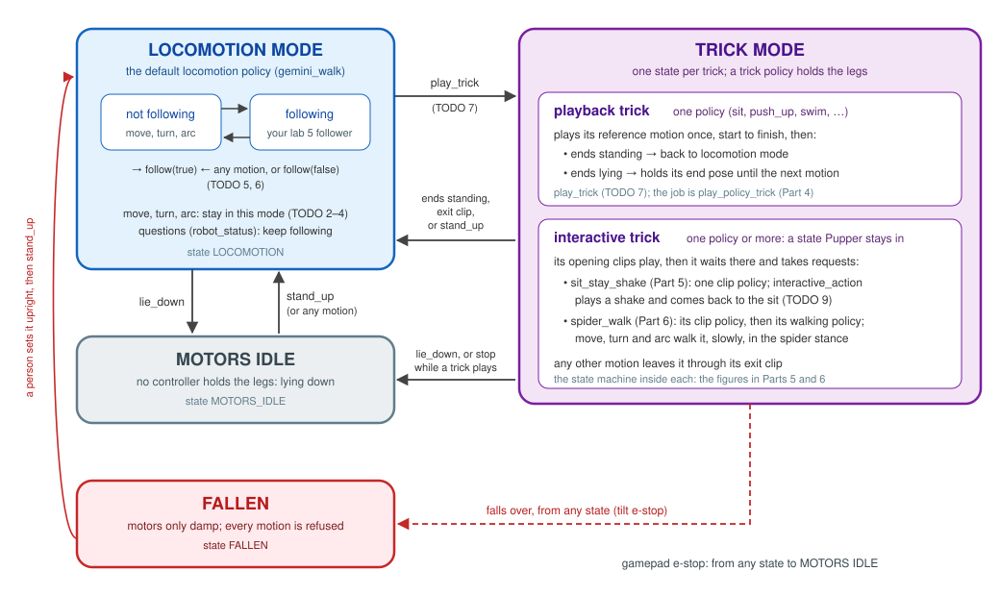
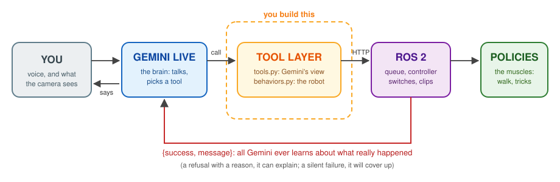
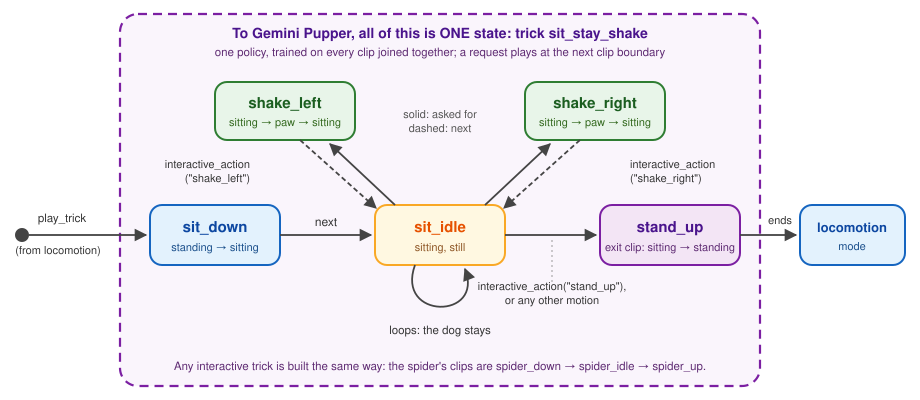
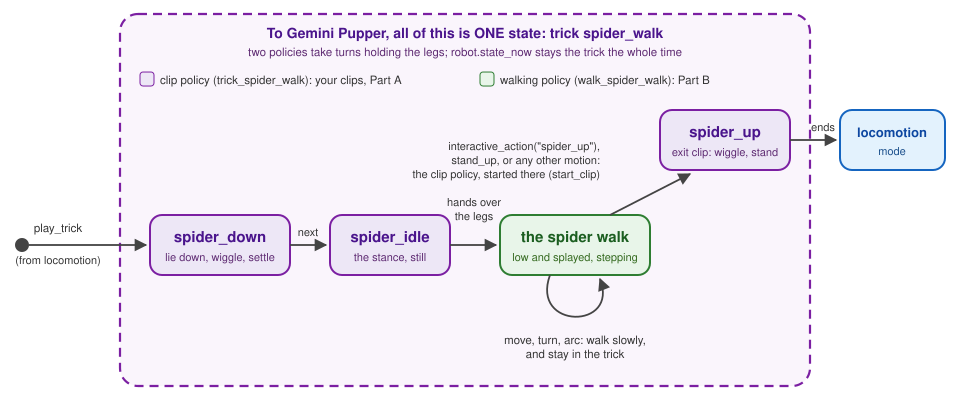
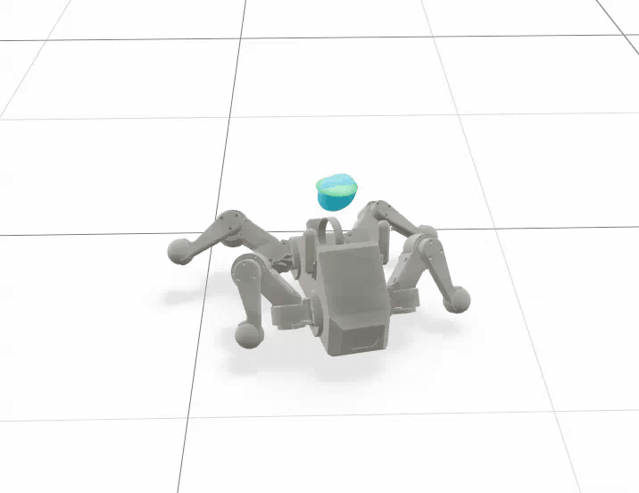

Lab 6: Bringing Your Pupper to Life
===================================

*The title is a tribute to Haochen Shi's PhD thesis,*
`Bringing life to robots <https://purl.stanford.edu/yf485jt4430>`_
*(Stanford University, 2026).*

*Goal: let a foundation model drive Pupper, safely. Gemini decides what to
do; the tools you write decide what it can do, and tell it what really
happened. Then train Pupper to sit, stay and shake a paw, and give Gemini
those moves too.*

.. TODO(staff): add this offering's lab slides link

`Lab slides <#>`_ (TODO)

`Lab document <https://docs.google.com/document/d/1kp3xRDpWT6fy1FBzcx5_VDpdCx2mRkD5-4JWlJbUOac/edit?usp=sharing>`_: make a copy, answer each DELIVERABLE under its
question number (Q1–Q19), and submit it to Gradescope.

.. note::

   **Gemini Pupper was created by** `Peng Xu <https://scholar.google.com/citations?user=460NWeQAAAAJ&hl=en>`_
   **(Google DeepMind).** This lab is built on his project
   (`sippeyxp/gemini-pupper <https://github.com/sippeyxp/gemini-pupper>`_), and the
   terminal chat you meet first (``lab/chat.py``) is based on his minimal Gemini
   Live example. Thank you, Peng!

Robot foundation models like Gemini can listen, look through a camera,
reason about what you want, and decide what to do. But a foundation model
cannot move a single motor. It can only **call tools**. In this lab, three
pieces work together:

* **Gemini Live** hears you, sees through the camera, decides what to do, and
  talks back.
* **The policies** drive Pupper's 12 motors, one policy at a time:

  - **Locomotion mode**: the default locomotion policy, from lab 4. It walks,
    turns and runs.
  - **Trick mode**: the trick's own policy controls the legs instead. A
    **playback trick** uses one **tracking policy**, trained (BeyondMimic-style)
    to follow a reference motion while keeping Pupper balanced. An
    **interactive trick** is a state that Pupper stays in, and it uses one or
    more policies: ``sit_stay_shake`` uses its clip policy, and the spider uses
    its clip policy plus its own walking policy. In this lab you will train two kinds of
    policy: tracking policies (``sit_stay_shake``, the spider's clips) and a
    walking policy (the spider walk).

  When no policy controls the legs, the motors go idle and Pupper lies down.

* **Gemini Pupper**, the system you build in this lab, connects the two. It
  decides which tools exist, what Gemini is told about them, what each one
  does on the robot, what it refuses, and what it reports back.

The idea to keep in mind: *a foundation model is only as good as its tools,
and it only knows what its tools tell it.* If a tool fails without reporting it, Gemini will tell you something false, such as "Okay, I'm walking!" while Pupper stands still.

Before You Start
----------------
In this lab you build a **human-robot interaction agent pipeline**, piece by
piece: from the words a person says, to the tool Gemini picks, to the policy
that moves the motors, and back to what Gemini tells the person. The amount
of code is moderate: most TODOs are a few lines to a few dozen. **The concepts behind them are difficult.** Almost every TODO deals with one of three hard
things: two things happening at the same time, something happening later than
you expect, or something Gemini can't see. Read the explanations, not just the TODO cards, and plan enough time for this lab: start early, and don't leave Part 5 (which trains a policy) for the
last days.

It is worth it. Gemini Pupper is one of the best starting points for a final
project that CS 123 has ever offered: a robot you can talk to, that walks,
follows people and does tricks you trained yourself. We expect great things
from the projects that build on it.

AI Use Suggestion
------------------
**This lab is designed so that you can complete it without AI.** You are
welcome to use a coding agent (Claude Code or Codex) to understand the code
and for light coding, as long as you understand what every line it writes
means. The repo comes with notes for your agent (``AGENTS.md``).

* **The deliverables are yours.** Answer every DELIVERABLE in your own words,
  from what you did and saw on your robot. Do not ask your agent to answer the questions.
* **Understand everything your agent does.** For every TODO, you should be
  able to explain what the code does, why it is written that way, and what
  would go wrong without it, without your agent open. Quiz 2 asks about this
  code.

Good ways to work with an agent are at the end of this handout, in
`Working With a Coding Agent`_. One rule always holds: never let an agent
move the robot, raise a limit, or weaken a test to make something pass.

.. important::

   **Safety rules for this lab.** Read them now. They apply to you *and* to
   your coding agent.

   * Test anything new with Pupper **on the ground, clear space around it, and
     your hand near the e-stop** (pressing the gamepad's right stick relaxes the motors, no matter what Gemini is doing). Never test on a table. Tricks look less stable on the stand than they really are, so test them on the ground.
   * **TA gate:** before your newly trained trick policy runs on the robot for
     the first time, show a TA its score and the simulation viewer. A badly
     trained trick can slam a paw or the body into the ground.
   * A coding agent never moves the robot on its own: no ``start.sh``, no
     ``chat.py --robot``, no ``curl`` to a POST endpoint, no ``ros2 topic
     pub``, unless you approve it at that moment, while standing at the robot.
   * **Pupper overheats.** Sitting and holding poses load the motors hard. If
     Pupper is hot to the touch or a motor faults, stop, relax the motors
     (``robot/stop.sh``), and let it cool.
   * Never put an API key in a file in your repo, a commit, or a chat you
     submit. The key goes in ``~/.config/gemini-pupper/api_key`` on the
     Pupper, never in the repo.

Lab roadmap
-----------
This lab is expected to take **two weeks**.

.. list-table::
   :class: wrap
   :header-rows: 1
   :widths: 10 64 26

   * - Part
     - What you do
     - TODOs
   * - 0
     - **Setup:** meet the loop on a fake robot; wake Pupper up; try what it can already do
     - (reading)
   * - 1
     - **Talk:** write the prompt, first pass
     - 1
   * - 2
     - **Walk:** refuse unsafe moves; read the walking job; implement the turn, move and arc tools; trace one command
     - 2, 3, 4
   * - 3
     - **Follow:** end follow mode before any other motion; implement the follow tool
     - 5, 6
   * - 4
     - **Tricks:** play any trick; read the trick job; tell Gemini which tricks exist
     - 7, 8
   * - 5
     - **Sit, stay, shake:** build a clip library, train it, give Gemini the actions
     - 9, 10 (+ notebook)
   * - 6
     - **The spider:** a trick that walks: build its clips and train its walking policy (reward weights, as in lab 4)
     - (notebook)
   * - 7
     - **Together:** finish the prompt (second pass); give Pupper a **personality**; record the demo; write your reflection
     - 11

**The big picture: you are building one big state machine**, like the one in
lab 5 but much bigger. Pupper is always in exactly one state. Every tool Gemini
calls either moves Pupper to another state, or refuses because that move can't
happen from the state Pupper is in (or the state it will be in, once everything
already queued has run). Keep this state machine in mind: each TODO adds a transition or a rule to it.

   Pupper's states, and the tools that move it between them. **Locomotion
   mode** is one state; follow mode can be on or off inside it. **Trick mode**
   has one state per trick. A **playback trick** uses one policy and plays its
   motion once. An **interactive trick** is a state Pupper stays in while it
   takes requests; it uses one policy (``sit_stay_shake``) or more (the
   spider, Part 6). Each interactive trick has its own state machine inside
   (Parts 5 and 6), but this diagram shows it as one state. In **motors
   idle**, Pupper lies down and no controller holds the legs. A tilt e-stop
   puts Pupper in **fallen**. Every motion tool switches straight to the state
   it needs: a walk from motors idle goes to locomotion mode, and a trick goes
   to that trick. Follow mode runs the follower you built in lab 5, without
   its obstacle avoidance.

The TODOs are numbered 1–11, in the same order as this handout. In the code,
you write each one between ``TODO n: YOUR CODE HERE`` banners. Above each one,
a short **card** tells you what happens now, what happens later, what Gemini
hears, what must always be true, which helpers to use, and what its tests
check. Some functions are already written and marked *finished: read it*. You
don't write those, but you should be able to explain them (Q4 and Q8 ask you
to).

Part 0: Setup
-------------
1. **Your Gemini API key.** Create one in
   `Google AI Studio <https://aistudio.google.com/apikey>`_.

   .. important::

      * **Sign in to Google AI Studio with your own personal Gmail account,
        not your Stanford account.**
      * **You might need some credits.** The Live API models the app uses
        may require billing or credits on your AI Studio account before your
        key works for them.

2. **Meet the loop (no robot needed).** Before you touch Pupper, look at the
   loop itself. Open the
   `Meet the Loop notebook <https://colab.research.google.com/github/cs123-stanford/gemini_pupper/blob/main/notebooks/Meet_the_Loop.ipynb>`_
   in Colab (**File → Save a copy in Drive**) and follow it. The notebook
   stores your key in Colab's Secrets, never in a cell. It runs ``lab/chat.py`` (based on a
   short example by Peng Xu), which gives Gemini the lab's prompt and tools
   (the same list the web app gets) and connects them to a **fake robot**.
   You type, Gemini answers, and the chat prints every tool call, every reply,
   and everything the fake robot did. Nothing moves.

   .. admonition:: Run: in Colab, in your copy of the notebook
      :class: run

      Run the cells from the top. The chat cell runs ``python3 lab/chat.py``:
      type at its ``You >`` prompt, and type ``quit`` to end it.

      No Colab? On your laptop, in a terminal:

      .. code-block:: bash

         git clone https://github.com/cs123-stanford/gemini_pupper.git
         cd gemini_pupper
         python3 -m pip install --user google-genai pyyaml
         export GEMINI_API_KEY=your-key-here
         python3 lab/chat.py

   Type *"lie down, then stand up, then walk forward"*. You will see something
   like this:

   .. code-block:: text

      You > lie down, then stand up, then walk forward
        -> Gemini calls lie_down({})
        <- reply Gemini hears now: {"success": true, "message": "lie down queued; the queue should finish in 1.0 s"}
           ...later, when the queue gets to it:
           [fake robot] legs: relaxed gemini_walk
           [fake robot] outcome: lie down: ok
        -> Gemini calls stand_up({})
        <- reply Gemini hears now: {"success": true, "message": "stand up queued; the queue should finish in 5.2 s"}
           ...later, when the queue gets to it:
           [fake robot] legs: gemini_walk took over
           [fake robot] outcome: stand up: ok
        -> Gemini calls move({"direction": "forward"})
        <- reply Gemini hears now: {"success": false, "message": "TODO 3 is not written yet (move in lab/part2_walk.py)"}
      Pupper > ...

   This loop is what the whole lab is about. Gemini never runs code. It reads
   the description of each tool (the ``@tool(...)`` lines in ``lab/``) and
   asks for a call; *your* code runs the call and sends back a reply. That
   reply is the only feedback Gemini gets about what the robot did.

   **We wrote four tools for you, in** ``lab/basics.py``: ``stand_up``,
   ``lie_down``, ``stop`` and ``robot_status``. Every other tool replies that
   its TODO isn't written yet. Watch what Gemini does with that reply.

   Now try two experiments in ``lab/basics.py`` (the notebook shows you how to
   edit the file in Colab). ``chat.py`` reads ``lab/`` only when it starts, so
   after each change, type ``quit`` and run the chat cell again (on your
   laptop, run ``python3 lab/chat.py`` again). When you're done, undo your
   changes:

   a. **The description determines the call.** Ask Pupper to *"take a nap"*. Then delete the
      sentence *"Use when the user says sleep, relax or lie down."* from
      ``lie_down``'s description (it spans two lines) and ask again. Last, change the description
      to ``"Makes the robot jump."`` and ask it to jump. What does Gemini call
      each time?
   b. **Gemini learns what happened only from the reply.** Make ``stand_up_tool`` return
      ``Result(False, "a wall is in the way")`` instead of calling
      ``stand_up``, and ask Pupper to stand up. Then make it return
      ``Result(True, "standing up")``, still without calling ``stand_up``. Now
      nothing reaches the fake robot (you see no ``[fake robot]`` lines). What does
      Gemini tell you each time?

   This is the fastest way to test any change to what Gemini reads, for the
   rest of the lab: edit the file, restart ``python3 lab/chat.py``, and type
   a request. For now you do this here. Once you have cloned your own repo
   onto the Pupper (step 3), you do it there, in ``~/gemini_pupper``. If you add
   ``--robot`` (``python3 lab/chat.py --robot``), the chat sends each call to
   the real robot server instead, just as a voice command does, and Pupper
   really moves. ``robot/start.sh`` must be running for that.

3. **Your code, on the Pupper.** Fork the `gemini_pupper <https://github.com/cs123-stanford/gemini_pupper>`_
   repository to your own GitHub account, following
   :doc:`forking_repositories`, and clone your fork onto the Pupper.

   .. admonition:: Run: on the Pupper, in your home folder
      :class: run

      From your laptop, open a terminal on the Pupper first:
      ``ssh pi@pupper[YOUR_GROUP_NUMBER].local``. Then:

      .. code-block:: bash

         cd ~/
         git clone https://github.com/YOUR_USERNAME/gemini_pupper.git

4. **Set it up.**

   .. admonition:: Run: on the Pupper, in ``~/gemini_pupper``
      :class: run

      .. code-block:: bash

         cd ~/gemini_pupper
         robot/setup.sh

   ``setup.sh`` installs what the app needs (without ``sudo``), builds the app,
   and asks for your key. It saves the key in
   ``~/.config/gemini-pupper/api_key`` on the Pupper, never in the repo. You
   can run ``setup.sh`` again at any time.

   Keep your Lab 5 repo (``~/follow_me_pupper``) on the Pupper: follow mode in
   Part 3 runs your Lab 5 code.

5. **Start the app.** Put Pupper on the ground in clear space. There are two
   ways to run the app:

   * **From your laptop: use this while you build and debug.** It is much easier for development: the debug view fills a large screen, and you can type as well as talk.

     .. admonition:: Run: on the Pupper, in ``~/gemini_pupper``
        :class: run

        .. code-block:: bash

           robot/start.sh

        It takes about a minute; wait for ``[3/3] ready``.

     .. admonition:: Run: on your laptop, in a new terminal (leave it open)
        :class: run

        .. code-block:: bash

           ssh -N -L 8000:localhost:8000 pi@pupper[YOUR_GROUP_NUMBER].local

        It prints nothing and keeps running: that is the port forward. Then, on
        your laptop, browse to ``http://localhost:8000``, open **Settings**, paste
        your key, and press **WAKE PUPPER**.

   * **On Pupper itself: use this for demos.** The app runs on Pupper's own
     screen, with its mic and speaker, and no laptop. This is how you record
     your demo videos.

     .. admonition:: Run: on the Pupper, in ``~/gemini_pupper``
        :class: run

        .. code-block:: bash

           robot/start.sh --kiosk

   Say hello to Pupper. The **debug view** shows every tool call Gemini makes and the
   robot's reply to it. Keep it open for the whole lab. To stop, run
   ``robot/stop.sh`` on the Pupper, in ``~/gemini_pupper``: it relaxes the
   motors and stops everything.

   .. list-table::
      :widths: 50 50

      * - .. image:: ../../../_static/lab6/app_face.png
             :width: 100%
        - .. image:: ../../../_static/lab6/app_debug_view.jpg
             :width: 100%

   The app has two views; use the buttons at the bottom to switch between
   them. **Left:** the face, which Pupper shows on its screen while you talk.
   **Right:** the debug view, with the camera, the log (each tool call and
   the robot's reply appear here as you talk), and manual controls (STOP,
   follow mode, the arrows, and every trick with its description).

   .. admonition:: Debugging tips
      :class: tip

      * **Start from the debug view.** It shows every function call Gemini
        made and the reply it heard. When Gemini says something unexpected, find the tool reply it was responding to.
      * **Read the logs on the Pupper.** ``/tmp/gemini-pupper/server.log``
        records your ``lab/`` code: every tool call, every job's outcome and
        every error. ``/tmp/gemini-pupper/robot.log`` records ROS 2: the
        controllers and policies. Watch one while you talk: on the Pupper, in a second
        terminal, ``tail -f /tmp/gemini-pupper/server.log``.
      * **Check the robot directly, not through Gemini.** Gemini only knows what the replies
        told it. To see what the robot is really doing, run
        ``curl localhost:8000/system/mode`` on the Pupper.
      * **Try it without the robot.** On the Pupper, in ``~/gemini_pupper``:
        ``python3 lab/chat.py`` runs the same conversation on the fake robot,
        and ``python3 lab/test.py todoN`` checks one TODO.
      * **Changed a** ``.py`` **file in** ``lab/``, **or a** ``trick.yaml``?
        Restart: on the Pupper, in ``~/gemini_pupper``,
        ``robot/stop.sh && robot/start.sh`` (``robot/start.sh --kiosk`` for
        the app on Pupper's screen). Changed ``lab/prompt.md``? Just
        reconnect in the app.
      * **The app won't start?** ``robot/start.sh`` prints the step where it
        got stuck: either the controllers are still loading (check
        ``robot.log``), or the server didn't start (check ``server.log``).

6. **What already works.** The provided tools are ``stand_up``, ``lie_down``,
   ``stop`` and ``robot_status``. In the app, try *"stand up"*, *"lie down"*, *"what are
   you doing?"*. Then ask Pupper to walk to you and to do a trick. Those
   tools exist, but they reply that their TODO isn't written yet. Watch what
   Gemini does with that reply.

   .. admonition:: TODO (staff): video

      A short video of Pupper not working: Gemini says it is walking while
      Pupper stands still.

7. **Run the tests once.**

   .. admonition:: Run: on the Pupper, in ``~/gemini_pupper``
      :class: run

      .. code-block:: bash

         python3 lab/test.py

   The checks for the provided robot code pass, and the test lists every TODO
   as not written yet.

**DELIVERABLE (Q1):**

(a) Step 2a: what did Gemini call after each change to ``lie_down``'s
description?

(b) Step 2b: what did Gemini tell you when ``stand_up`` failed? And when it
"succeeded" without the robot moving?

(c) Step 6: when you asked Pupper to walk, what did Gemini say, and what did
Pupper actually do?

(d) A robot that says it is doing something it isn't doing is bad
human-robot interaction. Why is it worse on a robot than in a chatbot? Why do
you think Gemini said it was doing something it wasn't?

How Gemini Pupper Works
-----------------------
You have seen the loop from the outside. Here is how it works inside,
starting from the code. Read this once now, and come back to it whenever a
TODO refers to it.

**You work in one folder: lab/.** When Gemini connects, the robot sends it a
prompt and a list of tools. When Gemini calls a tool, the robot runs it and
sends back a reply. You write the prompt and the tools, in ``lab/``:

   The loop you are building. Gemini picks a tool based on its *description*.
   Your code on the robot does the work and sends a reply, and that reply is
   how Gemini learns what actually happened.

.. code-block:: text

   gemini_pupper/
   ├── lab/                         ← you work here
   │   ├── prompt.md                who Pupper is and how it behaves        TODO 1, 6, 11
   │   ├── basics.py                read first: finished examples
   │   ├── part2_walk.py            check_move, walk, turn, move, arc       TODO 2, 3, 4
   │   ├── part3_follow.py          the follow rule, the follow tool        TODO 5, 6
   │   ├── part4_tricks.py          play_trick, the trick job (finished)    TODO 7, 8
   │   ├── part5_interactive_action.py  interactive_action, its tool                  TODO 9, 10
   │   ├── test.py                  python3 lab/test.py todo3   (tests on a fake robot)
   │   └── chat.py                  python3 lab/chat.py         (talk to Gemini in text)
   ├── tricks/                      one folder per trick
   ├── robot/                       provided: the Robot API, the robot server, launch files, scripts
   └── web/                         provided: the web app; you never need it

**The most important idea in this lab is that every motion tool runs in two
moments, now and later:**

* **Now**, the moment Gemini calls it, the tool checks that the request is
  allowed, puts a **job** in line for the robot, and replies right away. This
  reply is what Gemini hears: either the request was refused (and why), or it
  was accepted.
* **Later**, when the robot gets to the job, the job moves the robot. The
  job's **outcome** is what happened (done, fell over, controller failed). The
  robot writes it to the debug log and to ``robot_status``.

Tools work this way because Gemini often asks for several things in a single request
(*"stand up, then walk forward"*). The robot can only do them one at a time,
and Gemini should not stay silent until all of them are done. So every motion waits in a
**queue**, and every tool replies as soon as its job is in line.

**Here is how this looks in the code, for** ``stand_up``. It is the first
finished example in ``lab/basics.py``, and it has both parts: the tool Gemini reads, and the behavior that tool runs.

.. code-block:: python

   @tool("stand_up", "Stand up and turn on walking. Needed before moving, ..." + PREPARES_MOVE)
   async def stand_up_tool(robot: Robot) -> Result:            # what Gemini reads
       return await stand_up(robot)                              # (1)

   async def stand_up(robot: Robot) -> Result:                 # what the robot does
       note = await prepare_to_move(robot)                       # (2) NOW

       async def job() -> Result:                                # (3) defined now, run LATER
           return await robot.switch_to(LOCOMOTION_CONTROLLER)

       return with_note(note, await robot.queue("stand up", job, WALK_READY_S, then=LOCOMOTION))  # (4) NOW

Here is what happens when someone says *"stand up"*:

1. **Gemini calls the tool.** Gemini reads only the ``@tool(...)`` words,
   decides that ``stand_up`` is the right tool, and makes a **function call**
   (the Gemini API's name for a tool call). The robot server runs
   ``stand_up_tool``, which calls the behavior, ``stand_up``.
2. **Now: get ready.** ``prepare_to_move`` (your TODO 5) gets the robot ready
   for a new motion. It stops anything that runs *on its own, outside the
   queue*, that would conflict with the new motion. For now, nothing like that
   runs, so it does nothing and returns ``""``. In Part 3, you make it end
   follow mode (the person follower controls the legs directly) and return a
   note telling Gemini it did.
3. **Now: define the work for later.** ``async def job()`` *defines* the
   work without running it. Here the work is to give the legs to the
   locomotion policy. The job can use ``stand_up``'s variables (``robot``
   here; ``vx`` and ``duration`` in ``walk``). You can also write a job as a
   ``lambda``, a one-line function:
   ``job = lambda: play_policy_trick(robot, trick)`` is a job too.
4. **Now: queue it and reply.** ``robot.queue(name, job, seconds, then=...)``
   puts the job in line and returns right away with the *accepted* reply,
   ``"stand up queued; the queue should finish in 4.2 s"``. ``then=`` tells
   the queue which state Pupper will be in once the job is done (here,
   ``LOCOMOTION``). The queue saves it as ``robot.state_after_queue``, so the
   next request knows where Pupper will be when its turn comes. ``with_note``
   adds the note from step 2 to the front of the reply. Gemini hears this
   reply.
5. **Later: the job runs.** When every job ahead of it is done, the queue
   calls ``job()``. The robot writes the job's outcome, ``"stand up: ok"``, to
   the debug log and to ``robot_status``.

**Every motion in the lab has this shape: check now, queue a job, reply.**

**Here is the same idea on a timeline.** Someone says *"stand up and walk
forward"*, and Gemini makes two function calls, back to back:

.. list-table::
   :class: wrap
   :header-rows: 1
   :widths: 11 33 30 26

   * - Time
     - Gemini: function call → the reply it hears
     - The robot
     - The debug log (outcomes)
   * - 0.00 s
     - ``stand_up()`` → *"stand up queued; the queue should finish
       in 4.2 s"*
     - ``stand_up``: not following, nothing to stop; its job is queued.
     -
   * - 0.01 s
     - ``move(direction="forward")`` → *"move vx=0.4 … queued; the queue
       should finish in 5.7 s"*
     - ``walk``: ``check_move`` is happy; its job is queued behind
       stand_up's.
     -
   * - 0.01–4.2 s
     - (nothing: Gemini is talking to you)
     - stand_up's job: ``switch_to(gemini_walk)``, wait for the policy.
     - *"stand up: ok"*
   * - 4.2–5.7 s
     - (nothing)
     - walk's job: send the speed 20 times a second, then a zero.
     - *"move vx=0.4 …: moved vx=0.4 … for 1.5 s"*

Gemini heard both replies before Pupper took a single step. Tricks work the
same way. For *"sit, then shake"*, Gemini makes two function calls,
``play_trick("sit_stay_shake")`` and then ``interactive_action("shake_left")``.
Both get replies right away, but the shake's job starts only after the sit's
job is done.

.. important::

   **Gemini doesn't hear when a job finishes.** A tool replies the moment the
   queue *accepts* its job. When the job finishes later (done, fell over,
   controller failed), the robot writes its outcome to the debug log and to
   ``robot_status``, and sends nothing back to Gemini. Right after *"stand up
   and walk forward"*, Gemini knows only that both moves were queued. To learn
   what really happened, Gemini has to ask, by calling ``robot_status``. Q4
   asks what this means for a long walk.

**Python's async and await let the robot server do many things at once.** It
runs a job, answers Gemini, and listens for *"stop"* and the e-stop, all at
the same time. An ``async`` function can pause while it waits, and everything
else keeps running. You need only two rules:

* **Put** ``await`` **in front of every** ``async`` **call**:
  ``await robot.switch_to(...)``, ``await robot.sleep(0.05)``,
  ``await robot.queue(...)``. Without ``await``, the call never runs: Python
  creates the call but never runs it, and at most prints a warning that it
  "was never awaited".
* **Never** ``time.sleep``. It doesn't pause just your function; it freezes
  the whole server, including the ``stop`` tool and the e-stop. Use
  ``await robot.sleep(seconds)`` instead.

.. raw:: html

   

   
<b>New to async? A two-minute example (click to open)</b>

On your laptop, save this as ``example.py`` and run ``python3 example.py``:

.. code-block:: python

   import asyncio

   async def walk():
       print("walk: start")
       await asyncio.sleep(1.2)  # pause walk; everything else keeps running
       print("walk: done")

   async def listen():
       for _ in range(3):
           print("listen: did anyone say stop?")
           await asyncio.sleep(0.5)

   async def main():
       await asyncio.gather(walk(), listen())  # run both at once

   asyncio.run(main())

.. code-block:: text

   walk: start
   listen: did anyone say stop?
   listen: did anyone say stop?
   listen: did anyone say stop?
   walk: done

``await asyncio.sleep(1.2)`` pauses ``walk``, and ``listen`` runs in the
meantime. Now change it in two ways and compare the output:

* Change it to ``time.sleep(1.2)`` (and ``import time``): ``listen`` stays
  silent until the walk is over. On Pupper, the ``stop`` tool plays the
  part of ``listen``.
* Delete the ``await``: ``walk`` doesn't wait at all, and Python warns
  ``coroutine 'sleep' was never awaited``.

The robot server works the same way: ``robot.queue`` runs the jobs one at a
time, ``await``-ing each, while the server keeps answering Gemini and
listening for *"stop"*. More: the Python docs'
`Coroutines and Tasks <https://docs.python.org/3/library/asyncio-task.html>`_,
and Real Python's `Async IO in Python <https://realpython.com/async-io-python/>`_.

.. raw:: html

   

**Every tool and every job returns a** ``Result(ok, message)``. ``ok``
is ``True`` or ``False``, and ``message`` is the sentence that Gemini (or the
debug log) reads. Write each message for a person: say what happened, or what
was wrong and what would work instead.

``with_note(note, result)`` puts a short note in front of a ``Result``'s
message and keeps its ``ok`` as it is. If the note is empty (``""``), it
returns the ``Result`` unchanged. Use it when your code did something Gemini
should hear about along with the main reply. For example, ``prepare_to_move``
ended follow mode (``"Stopped following the person first. stand up queued;
..."``), or ``move`` walked instead of running sideways (``"Sideways never
runs; walking instead. move ... queued"``).

Every ``lab/`` file has the same two parts, in this order:

* **What the robot does**: the behaviors, like ``stand_up``. A behavior
  checks that the request is allowed, does it, and reports what happened.
* **What Gemini reads**: the tools. Each tool is a short function with an
  ``@tool(...)`` line above it. The ``@tool`` line gives the tool's name (the
  one Gemini calls), a description, and a description of each parameter. The
  function turns Gemini's words into numbers and calls a behavior. Gemini
  picks a tool, and fills in its parameters, from these words alone.

**Pupper is always in exactly one state**, set by whatever holds the
legs. In **locomotion mode** (``LOCOMOTION``), the default
locomotion policy holds them, on the ``gemini_walk`` controller, whether
Pupper is following someone or not. In **trick mode**, one trick's policy
holds them, on that trick's ``trick_<name>`` controller. In **motors idle**
(``MOTORS_IDLE``), nothing holds them, so Pupper lies down. After a fall,
Pupper is **fallen** (``FALLEN``). Every job changes the state with one call,
``robot.switch_to(...)``, and the robot keeps track of two states for you:

* ``robot.state_now``: the state Pupper is in right now. Only ``switch_to``
  changes it (and so do a fall, the e-stop and ``stop``).
* ``robot.state_after_queue``: the state Pupper will be in once everything
  already queued has run. Each ``robot.queue(..., then=...)`` call updates
  it.

When a tool is called (*now*), it checks ``state_after_queue``: where will
Pupper be when its turn comes? When its job runs (*later*), it checks
``state_now``: where is Pupper really? You will use both in Part 5.

**The tests run your code on a fake robot** (``python3 lab/test.py``). Each
TODO below ends with one Run box for its test, and a table of *every* check
that test makes, with an example that passes and one that fails. The test
checks nothing that isn't in the table.

Many checks look for a word or a number in what Gemini reads: a tool's reply
(``"... at most 20.0 s"``) or a description (``"follow"``). This is intentional.
Gemini knows only what you tell it. A reply that says ``"too fast"`` forces Gemini to guess; a reply that says ``"too fast: |vx|<=1.5 m/s"`` lets it retry at a speed
that works, or tell the person why it can't. **When you build tools for a
foundation model, include more information in every reply than you think you need: what
went wrong, what the limit is, and what the real choices are.**

**You need only these parts of the Robot API** (``robot/robot_api.py``):

.. list-table::
   :class: wrap
   :header-rows: 1
   :widths: 42 58

   * - Call
     - What it does
   * - ``await robot.queue(name, job, seconds, then=state)``
     - Put ``job`` (an ``async`` function with no arguments) in line, and
       return the *accepted* Result now. ``then``: the state Pupper is in once
       this job is done (``LOCOMOTION``, ``MOTORS_IDLE`` or a trick).
   * - ``await robot.switch_to(controller)``
     - Give the legs to one controller (``None``: relax the motors), and update
       ``robot.state_now``. Also stands up safely after a fall, and leaves an
       interactive trick through its exit clip before another motion takes
       the legs.
   * - ``robot.state_now``, ``robot.state_after_queue``
     - The state Pupper is in right now, and the one it will be in once
       everything already queued has run.
   * - ``robot.speeds()``
     - How Pupper walks in the state it will be in once the queue has run:
       its default speeds (``.walk`` in m/s, ``.turn`` in deg/s) and its
       ``MoveLimits`` (``.limits``). These are the normal values in
       locomotion mode, or the trick's own values inside a walking trick
       (Part 6).
   * - ``robot.send_speed(vx, vy, wz_deg)``
     - One speed command to the locomotion policy.
   * - ``await robot.sleep(s)``, ``robot.now()``
     - Wait without freezing the server; the time now. Never ``time.sleep``.
   * - ``robot.fallen``, ``FELL_MESSAGE``
     - Which controller fell over (``None`` while upright), and what to say.
   * - ``robot.following``, ``await robot.stop_following()``
     - Follow mode.
   * - ``await robot.is_active(controller)``
     - Is this controller driving the legs right now?
   * - ``await robot.play_clip(trick, clip)``
     - Play one clip of an interactive trick, and wait for it.
   * - ``robot.tricks``, ``robot.action_ids()``
     - The installed tricks; interactive actions → (trick, clip).
   * - ``with_note(note, result)``
     - The same ``Result``, with ``note`` in front of its message (unchanged
       if ``note`` is ``""``).

Part 1: Talk
------------
Open ``lab/prompt.md``. It has six headings, each with a question under it.
You fill it in over the lab: the first three sections now, *Follow mode* in
Part 3, and the last two in Part 7.

**TODO 1:** In ``lab/prompt.md``, write the first three sections: *Who you
are*, *How you move*, and *When a tool says no*.

- **Who you are.** Give Pupper a personality and a way of talking. Everything
  Gemini says is spoken out loud, so short sentences work best.
- **How you move.** Pupper can only move by calling a tool. Should it call the
  tool first and talk after, or the other way around? (Think about what
  happens if it says "I'm walking!" and the tool then refuses.) What must it
  never say?
- **When a tool says no.** Every tool reply says what really happened. What
  should Pupper do when a tool refuses, or says its TODO isn't written yet?
  What should it never pretend?

Gemini follows short, concrete rules much better than vague goals.
Compare:

.. code-block:: text

   Vague:     Be honest about what you can do.
   Concrete:  You can only move by calling a tool. Never say you are moving,
              sitting or doing a trick unless you called the tool for it.

A good rule says *when* (in which situation), *what to do*, and, if it
matters, *what never to do*. Use bullet points: one rule per bullet.

After editing the prompt, try it in text first (``chat.py`` reads
``prompt.md`` every time it starts):

.. admonition:: Run: on the Pupper, in ``~/gemini_pupper``
   :class: run

   .. code-block:: bash

      python3 lab/chat.py

Then reconnect in the app (no restart needed), ask for a walk again, and
compare with Q1.

.. admonition:: Run: on the Pupper, in ``~/gemini_pupper``
   :class: run

   When: the three sections of ``lab/prompt.md`` are written.

   .. code-block:: bash

      python3 lab/test.py todo1

   This runs a test that checks your TODO 1 code. The table below lists
   every check it makes, with an example that passes and one that fails. If
   a check fails, the test prints what your code produced next to an example
   that passes.

.. list-table::
   :class: wrap
   :header-rows: 1
   :widths: 30 35 35

   * - Check
     - Passes
     - Fails
   * - The three sections are written
     - your own rules under each heading
     - a heading still says TODO (the checks are skipped)
   * - They have 60+ words together
     - a few bullet points under each heading
     - "Be nice. Use tools."
   * - They say ``"tool"``
     - "You can only move by calling a tool."
     - "You can walk, turn and do tricks."

These checks can only look for words. In Q2, you will test whether Gemini actually *follows* your rules by talking to it.

**DELIVERABLE (Q2):** Pick two rules from your prompt. For each: what did
Gemini do before you wrote it, and what does it do now? Is the sentence in
the prompt enough, or will the robot also have to make sure of it in code?

Part 2: Walk
------------
In this part, you make Pupper walk, turn, run and curve by voice, and refuse
moves it must not make. When Gemini asks for a walk or a turn, the request
passes through three functions in ``lab/part2_walk.py`` on its way from the
words to the motors:

.. code-block:: text

   "walk forward"  ->  move (TODO 3)                     words  -> vx, vy, duration
   "turn left"     ->  turn (TODO 3)                     words  -> wz_deg, seconds
   "go in a circle" -> arc (TODO 4)                      words  -> vx, wz_deg, seconds
                   ->  walk (finished: read it)          check now, queue the job
                         -> check_move (TODO 2)          is this move allowed?
                         -> the job, later               20 speed messages a second

You build them in the order they appear in the file: first the safety check,
then you read the walking job, then you write the tools Gemini calls
(``turn`` first, then ``move``), and last ``arc``, which walks and turns at
the same time.

**TODO 2:** Implement ``check_move`` in ``lab/part2_walk.py``, so that it
refuses what the robot can't or shouldn't do.

Here is why ``check_move`` matters. Most refusals don't come from a missing
tool. Usually Gemini
finds the right tool but calls it with values the robot can't or shouldn't
handle: 3 m/s, a 30-second walk, or a speed so low that the legs only shuffle in place.
For example, if someone says *"Sit, then run 100 mph"*, Gemini calls ``move``
with a speed far over the limit. (You'll meet the other kind of refusal, a
request with no tool at all like *"do a backflip"*, in Part 4.) Your tool
descriptions *ask* Gemini to stay within the limits; ``check_move`` *makes
sure* it does. It is the easiest place to start.

.. tip::

   Remember: a function needs ``async def`` only if its body has to
   ``await`` something that takes time (see *async and await* above). Do any
   of the checks in ``check_move`` need time for the robot to do something?

``check_move`` takes a velocity (``vx`` forward and ``vy`` left, in m/s;
``wz_deg`` counter-clockwise, in deg/s) and a ``duration`` in seconds. It
returns ``None`` if the move is allowed, or a sentence saying why not. You'll
find the limits in ``MoveLimits``, at the top of ``robot/robot_api.py``. Check
them one at a time, and return the first problem you find:

1. **Too fast:** ``abs(vx) > limits.vx_max``, or the same for ``vy`` and
   ``wz_deg``. (``abs``, because backward and right are negative.)
2. **Too slow to move at all:** ``vx``, ``vy`` *and* ``wz_deg`` are all below
   their minimums (``vx_min``, ``vy_min``, ``wz_min``). Refuse only if all
   three are: a turn in place has ``vx = vy = 0``, and that is a valid move.
3. **Duration:** it must be more than 0 and at most ``limits.duration_max``.
4. **Too far:** the distance is speed × duration, where speed is
   ``(vx**2 + vy**2) ** 0.5``. Refuse if it is more than
   ``limits.distance_max``.
5. **Nothing wrong:** return ``None``.

.. important::

   **Your reason must name the limit, and the tests check for it.** Gemini
   receives the string you return, word for word, as the tool's reply. That
   is how Gemini learns why the robot refused. With only ``"too fast"``, Gemini has to guess a new speed, and it may guess wrong again or give up. With ``"too fast: |vx|<=1.5 m/s"``, it can retry at a speed that works, or tell you why it can't. Build the number from the ``MoveLimits`` field in an f-string, so the message stays correct if a limit changes.

.. admonition:: Run: on the Pupper, in ``~/gemini_pupper``
   :class: run

   When: ``check_move`` is written.

   .. code-block:: bash

      python3 lab/test.py todo2

   This runs a test that checks your TODO 2 code. The table below lists
   every check it makes, with an example that passes and one that fails. If
   a check fails, the test prints what your code produced next to an example
   that passes.

   It also runs the finished ``walk`` (below) with your ``check_move``, so you
   see refused moves come back as failures with your reason.

.. list-table::
   :class: wrap
   :header-rows: 1
   :widths: 30 35 35

   * - Check
     - Passes
     - Fails
   * - Allows good moves, even exactly at a limit
     - ``check_move(1.5, 0, 0, 1.0)`` returns ``None``
     - refusing it because you wrote ``>=`` instead of ``>``
   * - Refuses each bad move with a reason: too fast (forward, backward, sideways, turning), too slow on all three, a zero or negative duration, longer than ``duration_max``, farther than ``distance_max``
     - ``"duration must be more than 0 and at most 20.0 s"``
     - ``None``, or ``""``
   * - The reason contains the limit's number, as Python prints it: ``1.5`` (vx_max), ``0.5`` (vy_max), ``114.0`` (wz_max), ``20.0`` (duration_max), ``7.0`` (distance_max)
     - ``f"... at most {limits.duration_max} s"`` gives ``"... at most 20.0 s"``
     - ``"too long"`` (no number); ``f"{limits.duration_max:.0f}"`` gives ``"20"``
   * - (finished ``walk``) Gemini hears your reason, limit included
     - ``walk(robot, 5.0, 0, 0, 1.0)`` fails with ``"too fast: limits are |vx|<=1.5 m/s, ..."``
     - ``"too fast"``

The other checks, under *(provided) walk*, test the finished ``walk``. They
pass once ``check_move`` works.

**Now read** ``walk``, **in** ``lab/part2_walk.py``. This function follows the shape of ``stand_up``, with a loop in the job section. We have implemented it all for you, but make sure that you understand it. Here is how it works:

* **Now,** ``walk`` asks your ``check_move`` whether the move is allowed,
  and if it isn't, refuses with its reason. It calls ``prepare_to_move`` to get
  the robot ready (for now this does nothing; you write it in Part 3, TODO
  5). It also refuses if the robot has already fallen.
* **Later,** the job hands the legs to the locomotion policy. Then it
  sends the speed with ``robot.send_speed`` 20 times a second
  (``LLM_CMD_RATE``) until the duration is up, and finishes by sending a zero
  speed.
* **The job sends the speed in a loop** because the locomotion policy can't
  follow a command like "walk for 2 seconds": it needs a speed command, sent
  over and over. A node called ``cmd_vel_mux`` sits between Gemini and the
  policy and lets your joystick override Gemini. ``cmd_vel_mux`` drops any
  speed it hasn't heard for half a second, so if your program crashes, Pupper
  stops instead of walking forever.
* ``walk`` **checks** ``robot.fallen`` **three times**, because the robot can
  fall at three different moments: before Gemini asks, while the job waits in
  line, or while it walks. Whenever it falls, the outcome should say so, not
  "moved".
* **Gemini never hears the outcome.** It already heard *"move ... queued"*
  the moment ``walk`` returned. The outcome, ``"moved ..."`` or
  ``"the robot fell over ..."``, goes only to the debug log and
  ``robot_status`` (see *Gemini doesn't hear when a job finishes*, above).

**TODO 3:** Implement the ``turn`` and ``move`` tools (the ones Gemini
calls), near the bottom of ``lab/part2_walk.py``.
Write ``turn`` first. It is short, it shows the whole path from Gemini's words to the robot, and the TODO 3 test checks it separately. Then write ``move``, the hardest part of this section.

Gemini chooses a tool, and fills in its parameters, using only the words in
``@tool(...)``: the tool's description and each
parameter's description. In each tool, replace every ``TODO 3`` in those
words:

- Say what the tool does and when to use it. Include the robot's actual limits in the description: the ``f"..."`` strings can use ``LIMITS.vx_max``,
  ``LIMITS.duration_max`` and the others, so they stay correct if a limit changes. Add ``+ PREPARES_MOVE`` to the description (Part 3 explains it).
- For each parameter, give its unit (m/s, seconds, degrees), its range, and
  its default.
- Give a worked example wherever Gemini has to do arithmetic or pick a number.
  When we tested our own solution, *"walk forward 2 meters"* walked only
  0.6 m until we added *"Distance = speed x duration: 2 m at 0.4 m/s is 5 s"*
  to ``duration``'s description, and *"walk in a square"* came out with 45°
  corners until we added *"90 a square's corner, 120 a triangle's"* to
  ``angle``'s description.

**Write** ``turn`` **first.** To turn in place, send only a turning speed (no forward or sideways speed) for as long as the angle requires:

1. Get the turning speed: ``turn_speed = robot.speeds().turn``, which is
   60 deg/s in locomotion mode. (A trick that walks in its own stance, like
   the spider in Part 6, turns at its own speed; ``robot.speeds()`` gives the
   speeds for the state Pupper will be in when the turn runs.) Set ``wz_deg``
   to ``+turn_speed`` to turn left (counter-clockwise), or ``-turn_speed`` to
   turn right.
2. Work out how long the turn takes: ``seconds = abs(angle) / turn_speed``.
   For example, 90 degrees at 60 deg/s takes 1.5 s.
3. Pass the values to ``walk``: ``return await walk(robot, 0.0, 0.0, wz_deg, seconds)``.

**Then write** ``move``. Gemini calls ``move`` with a ``direction`` and, optionally, ``run``, ``speed`` and ``duration``. Any argument Gemini leaves
out takes the default from the function's signature (``speed`` is ``None``
when Gemini doesn't give one). Your job is to turn these into one speed, and
then split that speed into ``vx`` and ``vy``.

1. **Work out the speed.**

   - Pupper is *running* when ``run`` is true **and** the direction is
     forward or backward. A running speed is at least ``RUN_MIN_SPEED``
     (1.0 m/s); if Gemini gave no speed, use ``RUN_DEFAULT_SPEED`` (1.2 m/s).
     ``max(a, b)`` gives the bigger of two numbers, so
     ``max(0.6, RUN_MIN_SPEED)`` is 1.0.
   - *Otherwise* (walking, or any sideways move, since sideways never runs),
     use ``speed``, or 0.4 m/s if Gemini gave none.

2. **Split it by direction.** The robot's convention is +x forward and
   **+y left**, the opposite of what many people expect:

   .. list-table::
      :header-rows: 1
      :widths: 25 25 25

      * - direction
        - vx
        - vy
      * - forward
        - +speed
        - 0
      * - backward
        - −speed
        - 0
      * - left
        - 0
        - +speed
      * - right
        - 0
        - −speed

3. **Report what you changed.** If Gemini asks to run sideways, your code walks instead. Nothing fails, so without a note the reply would only say "queued", and Gemini would tell the person "Running left!" while Pupper walks. Start the
   reply with a note:

   .. code-block:: python

      note = "Sideways never runs; walking instead. " if run and sideways else ""
      return with_note(note, await walk(robot, vx, vy, 0.0, duration))

   ``with_note`` (provided) puts the note in front of ``walk``'s message.

Check your logic against these examples before you run anything. These are
exactly the cases the tests check:

.. list-table::
   :class: wrap
   :header-rows: 1
   :widths: 48 26 26

   * - Gemini calls
     - vx (m/s)
     - vy (m/s)
   * - ``move(direction="forward")``
     - 0.4
     - 0
   * - ``move(direction="backward", speed=0.3)``
     - −0.3
     - 0
   * - ``move(direction="left", speed=0.3)``
     - 0
     - 0.3
   * - ``move(direction="backward", run=True)``
     - −1.2
     - 0
   * - ``move(direction="forward", run=True, speed=0.6)``
     - 1.0 (run means at least 1.0)
     - 0
   * - ``move(direction="right", run=True)``
     - 0
     - −0.4 (sideways never runs)

In this lab, "run" means **1.0 m/s or faster**, even though the locomotion
policy already switches to its running gait at about 0.5 m/s. Gemini might
still call ``move(run=true, speed=0.6)``, so the rule has to be in your code,
not only in the description. (Q3 asks about it.)

.. tip::

   This follows the same principle as TODO 2: **whenever your code changes what Gemini asked for, the reply must say so.** Gemini only knows what the reply tells it. If your code changes a request without reporting it, Gemini will tell the person something incorrect. (We missed this case ourselves when we wrote the lab.)

.. admonition:: Run: on the Pupper, in ``~/gemini_pupper``
   :class: run

   When: ``turn`` is written (the ``move`` checks say not written yet until ``move`` is), and again when ``move`` is written.

   .. code-block:: bash

      python3 lab/test.py todo3

   This runs a test that checks your TODO 3 code. The table below lists
   every check it makes, with an example that passes and one that fails. If
   a check fails, the test prints what your code produced next to an example
   that passes.

.. list-table::
   :class: wrap
   :header-rows: 1
   :widths: 30 35 35

   * - Check
     - Passes
     - Fails
   * - ``turn`` and ``move`` each have a description of 20+ characters, and every parameter is described
     - ``"Turn in place to the left or right." + PREPARES_MOVE``
     - ``"turn"``, or a parameter still saying ``"TODO 3"``
   * - ``turn("left", 90)`` sends a positive turn rate, about 90° in all (70–110), with ``vx = vy = 0``
     - ``wz_deg = +turn_speed`` for 1.5 s
     - ``-turn_speed``; or ``seconds = angle`` (90 s)
   * - ``turn("right", 90)`` sends a negative turn rate
     - ``wz_deg = -turn_speed``
     - ``+turn_speed``
   * - ``move``'s words contain ``LIMITS.vx_max`` (``1.5``)
     - ``f"running {RUN_MIN_SPEED}-{LIMITS.vx_max} m/s"``
     - ``"runs fast"``, or a typed-in ``1.5`` (it passes, but goes stale)
   * - ``move``'s words contain ``"follow"``
     - ``"..." + PREPARES_MOVE``
     - leaving ``PREPARES_MOVE`` out
   * - The six ``move`` examples in the table above send exactly those speeds
     - ``move("right", run=True)`` sends ``vy = -0.4``
     - ``vy = -1.2`` (running sideways)
   * - ``move("right", run=True)``'s reply says ``"walk"``
     - ``"Sideways never runs; walking instead. move vx=0 vy=-0.4 ... queued"``
     - ``"move vx=0 vy=-0.4 ... queued"`` (Gemini then says it's running)
   * - A move ``check_move`` refuses comes back as a failure with its reason
     - ``move("forward", speed=1.5, duration=10)``: ``"that would travel 15.00 m, more than 7.0 m in one move: split it into shorter moves"``
     - a success, or a crash

**TODO 4:** Implement the ``arc`` tool, at the very bottom of
``lab/part2_walk.py``, so that Pupper can walk and turn at the same time.

``turn`` sends only a turning speed, and ``move`` sends only a straight one.
If you ask for "a circle" with just those two tools, the best Gemini can do is
chain them: Pupper walks, stops, turns, and walks again. But ``walk`` can take
``vx`` and ``wz_deg`` together, and the locomotion policy was trained on both
at once. ``arc`` lets Gemini ask for a smooth curve.

We give you its parameters, so the tests can check them: ``direction`` (left or
right), ``angle`` (degrees of the circle to go around, **required**), ``radius``
(m, default 0.5) and ``speed`` (m/s, default 0.4). You write the words and the
body. ``angle`` intentionally has no default. When it had a default of 90,
Gemini asked for "a circle" by leaving ``angle`` out, and Pupper walked only a
quarter of one.

**Here is the math.** When Pupper goes around a circle of radius *r* at speed *v*,
it turns *v / r* radians per second. ``walk`` needs degrees per second, and
you get the time from the angle:

.. code-block:: python

   wz_deg = math.degrees(speed / radius)   # + to the left, - to the right
   seconds = abs(angle) / abs(wz_deg)
   return await walk(robot, speed, 0.0, wz_deg, seconds)

.. list-table::
   :class: wrap
   :header-rows: 1
   :widths: 46 54

   * - Gemini calls
     - What happens
   * - ``arc(direction="left", angle=90)``
     - vx 0.4, wz +45.8 deg/s for 1.96 s: a quarter circle
   * - ``arc(direction="right", angle=180, radius=1.0, speed=0.6)``
     - vx 0.6, wz −34.4 deg/s for 5.24 s: a U-turn
   * - ``arc(direction="left", angle=360, radius=1.0)``
     - vx 0.4, wz +22.9 deg/s for 15.7 s: a circle 2 m across (6.3 m of path)
   * - ``arc(direction="left", angle=90, radius=0)``
     - a sharp corner: turns in place, like ``turn``, and says so: ``"Radius 0: turned in place (a sharp corner). move ..."``
   * - ``arc(direction="left", angle=90, radius=0.1)``
     - refused by *your* code, with what works: ``"too tight: at 0.4 m/s the radius must be at least 0.25 m"``
   * - ``arc(direction="left", angle=360, radius=1.5, speed=1.2)``
     - refused by ``check_move``: ``"that would travel 9.42 m, more than 7.0 m in one move: split it into shorter moves"``
   * - ``arc(direction="left", angle=90, radius=-1)``
     - refused by your code: ``"no arc: radius must be 0 m or more ..."``

Your ``arc`` has to handle three cases: the first two in its code, the third
in its description. Each one fixes a problem we saw when Gemini used an
``arc`` that didn't handle it.

- **In the code: refuse a too-tight arc yourself, and say what radius works.**
  Before you call ``walk``, compute the smallest radius Pupper can manage at
  this speed, ``speed / math.radians(wz_max)`` rounded up, where
  ``wz_max = robot.speeds().limits.wz_max`` (``LIMITS.wz_max`` when walking
  normally). If Gemini's radius is smaller, return a failure that gives that
  radius, like ``"too tight: at 0.4 m/s the radius must be at least 0.25 m"``.
  When Gemini gives no speed, use ``robot.speeds().walk`` (0.4 m/s when
  walking normally). *Why not leave it to* ``check_move``? It would refuse
  the arc too, but its reason is ``"|wz|<=114.0 deg/s"``, and from that
  Gemini can't tell that the *radius* is the problem: when we asked it to
  "run in a circle", it sent the same arc five times.
- **In the code: radius 0 is a sharp corner, not an error.** Gemini plans a whole shape
  and sends every call at once, and it often asks for corners as
  ``arc(radius=0)``. When our code refused those calls, the sides still ran,
  so "walk in a rectangle" came out as one straight line. ``speed / 0`` would
  crash anyway, so handle radius 0 before the math: turn in place, as
  ``turn`` does, and put a note in front of the reply (``with_note``, as in
  TODO 3). Refuse a negative radius, and a speed of 0 or less.
- **In the description: give Gemini the limits,** computed from ``LIMITS``. The
  tighter the circle, the faster Pupper has to turn, and it can turn at most
  ``LIMITS.wz_max`` deg/s. So at speed *v*, the smallest radius is
  ``v / math.radians(LIMITS.wz_max)``: about 0.2 m at a walk and 0.6 m at a
  run. One arc can go at most ``LIMITS.distance_max`` m. Also say what
  ``arc`` is *not* for: shapes with straight sides and sharp corners (a
  square, a star) need ``move`` and ``turn``.

.. admonition:: Run: on the Pupper, in ``~/gemini_pupper``
   :class: run

   When: ``arc`` is written.

   .. code-block:: bash

      python3 lab/test.py todo4

   This runs a test that checks your TODO 4 code. The table below lists
   every check it makes, with an example that passes and one that fails. If
   a check fails, the test prints what your code produced next to an example
   that passes.

.. list-table::
   :class: wrap
   :header-rows: 1
   :widths: 30 35 35

   * - Check
     - Passes
     - Fails
   * - ``arc`` has a description of 20+ characters, and every parameter is described
     - ``"Walk forward and turn at the same time, around part of a circle ..."``
     - ``"arc"``, or a parameter still saying ``"TODO 4"``
   * - Its words contain ``LIMITS.distance_max`` (``7.0``) and ``"follow"``
     - ``f"... One arc goes at most {LIMITS.distance_max} m." + PREPARES_MOVE``
     - ``"Walk in a curve."``
   * - ``arc("left", angle=90, radius=0.5)`` sends ``vx = +0.4``, ``vy = 0``, ``wz = +45.8`` deg/s, and turns about 90° (70–110)
     - ``wz_deg = math.degrees(speed / radius)``
     - ``vx = 0`` (a turn in place); or ``wz_deg = speed / radius`` (0.8: that's rad/s, and ``check_move`` refuses the 112 s it then takes)
   * - ``arc("right", angle=90, ...)`` sends a negative ``wz``, still going forward
     - ``wz_deg = -45.8``, ``vx = +0.4``
     - ``vx = -0.4`` (that backs up)
   * - ``arc("left", angle=90, speed=0.6, radius=1.0)`` sends ``vx = 0.6``, ``wz = +34.4`` deg/s
     - ``vx = speed``
     - ``vx = 0.4`` (the speed ignored)
   * - ``arc("left", angle=90, radius=0)`` turns in place, left, about 90°, and the reply says ``"place"``
     - ``"Radius 0: turned in place (a sharp corner). move vx=0 ... queued"``
     - a crash (dividing by 0), or a refusal
   * - ``arc("left", angle=90, radius=-1)`` is a failure that says ``"radius"``, and sends nothing
     - ``"no arc: radius must be 0 m or more ..."``
     - a success, or a crash
   * - ``arc("left", angle=90, radius=0.1)`` (229 deg/s) fails, says ``"radius"``, and gives the smallest radius (0.2–0.3 m)
     - ``"too tight: at 0.4 m/s the radius must be at least 0.25 m"``
     - ``check_move``'s ``"too fast: ... |wz|<=114.0 deg/s"``; or a success that quietly turned slower

.. admonition:: Run: on the Pupper, in ``~/gemini_pupper``
   :class: run

   When: TODOs 2–4 pass their tests. Try your words in text first:

   .. code-block:: bash

      python3 lab/chat.py

In the chat, ask for a run, a sidestep, a turn,
*"run in a circle around me"* (did Gemini pick a radius the robot can do?), and
a shape: *"walk in a rectangle"*, *"walk a star"*, *"trace the letter D"*. The
chat shows you the exact call Gemini makes and the speeds your code sends to
the (fake) robot. If Gemini has trouble with shapes, add one sentence to your
prompt's *How you move* section: shapes and letters take several calls in a
row (a straight line, a sharp corner, a curve), and Gemini should plan them
first, then call them in order.

.. admonition:: Run: on the Pupper, in ``~/gemini_pupper``
   :class: run

   Last, restart, so the app runs your new code:

   .. code-block:: bash

      robot/stop.sh && robot/start.sh      # add --kiosk for the app on Pupper's screen

Then reconnect in the app and try it by voice.

.. note::

   **Checkpoint: a refusal Gemini can explain.** Get Gemini to call your
   motion tool with a request the robot refuses, and explain the refusal to
   you using *only the robot's reply*. If your descriptions are good enough that Gemini never asks for anything impossible, try a request that fits the tool but breaks another rule. For example, "run forward for ten
   seconds" goes more than 7 m. Show a TA the conversation and the debug view.

Here is what a finished Part 2 can do: run, turn, walk shapes, and even draw
letters, all by voice.

.. youtube:: MN6Rts2vVfs
   :width: 640
   :height: 360

**DELIVERABLE (Q3):** Paste your ``turn``, ``move`` and ``arc`` descriptions,
and write one sentence for each about a choice you made (which parameters,
which defaults, what the description promises). Where does your code enforce
"run means at least 1.0 m/s", and why there?

**DELIVERABLE (Q4):** These questions are about the finished ``walk``.
(a) Why does ``walk`` send the speed 20 times a second, and what would Pupper
do if ``walk`` sent it only once? What would happen if ``walk`` waited with
``time.sleep`` instead of ``await robot.sleep``? (b) Ask Pupper for a
5-second walk. What does Gemini hear right away, and what does it believe at
that moment? When, if ever, does Gemini learn that the walk failed (say,
Pupper fell over halfway)? Describe one situation
where this matters, and one way you could fix it.

**DELIVERABLE (Q5):** Trace one voice command, *"stand up"*, from Gemini to
the controller switch. We give you the first and last steps; fill in every
file and function in between, and mark each step *now* (before the reply goes back
to Gemini) or *later* (when the queue gets to the job):

.. code-block:: text

   1. web/services/geminiLive.ts   a toolCall arrives; the app calls robotBridge.callTool("stand_up", {})   now
   2. ...
   ...
   n. robot/robot_api.py           Robot.switch_to(LOCOMOTION_CONTROLLER): the locomotion policy takes the legs   later

Use a coding agent or read the code yourself (start at the ``stand_up`` tool
in ``lab/basics.py``, and work outward in both directions). Check your trace
against the robot server's log (``/tmp/gemini-pupper/server.log``, on the Pupper). If an
agent helped, point out anything it got wrong, skipped or made up.

Part 3: Follow
--------------
Follow mode runs the person follower you built in lab 5: camera → person
detection → your state machine → walking, with your target lock and stop
distance. It leaves out lab 5's obstacle avoidance, which isn't reliable enough to use while Gemini is in control. Pupper follows you in a straight line, so you
have to lead it around furniture. Follow mode needs one rule:

   *Questions and conversation keep following. Any motion (walk, turn, arc,
   trick, stand up, lie down) ends follow mode, and Pupper says so first:
   "Let me stop following you and ..."*

.. note::

   **Follow mode needs your Lab 5 code.** When Gemini follows someone, the robot runs
   your ``lab/follow_me.py`` state machine, with your target lock and stop
   distance, through ``robot/follow_service.py`` in ``~/follow_me_pupper``. So
   keep that repo on the Pupper with its model downloaded, and keep Lab 5's
   Steps 2–4 working (``python3 lab/test.py`` all passing, run in
   ``~/follow_me_pupper`` on the Pupper). Follow mode calls your
   ``process_detections``, ``pick_target`` and ``approach_speed``, and crashes
   if any of them isn't written yet. Follow mode leaves Lab 5's optional steps
   off: color re-identification (Step 5) and obstacle avoidance (Step 6)
   aren't reliable enough to use while Gemini is in control. To keep Pupper cooler,
   the Hailo runs only while Pupper is following, so Pupper's on-screen eyes
   track people only during follow mode. For eyes that track people all the
   time, start the app with ``FOLLOW_ALWAYS_DETECT=1 robot/start.sh`` (on the
   Pupper, in ``~/gemini_pupper``); Pupper runs warmer that way. If
   ``~/follow_me_pupper`` is missing, follow mode falls back to the monorepo's
   simpler follower.

We provide the code that turns the follower on and off
(``robot.set_following``). You implement the follow rule in two parts: the code that enforces it (TODO 5), and the descriptions that tell Gemini about it (TODO 6).

**TODO 5:** Implement ``prepare_to_move`` in ``lab/part3_follow.py``. It gets the
robot ready for a new motion. Every motion calls it first, in its *now* part:
you can see the call in ``stand_up`` and ``lie_down`` (``basics.py``) and in
``walk`` (``part2_walk.py``). So whatever you write here applies to every
motion at once.

Before a new motion is queued, ``prepare_to_move`` stops
anything that runs on its own, outside the queue. In Gemini Pupper, only one
thing does: the person follower. So for now, its one job is to end follow
mode. Later, if you add anything else that runs on its own, ``prepare_to_move``
is where you stop it. Getting the *legs* ready is a different job:
``switch_to`` does that later, when the job runs, because by then Pupper may
be in a different state than when the job was queued.

.. list-table::
   :class: wrap
   :header-rows: 1
   :widths: 40 26 34

   * - If you add…
     - put it in…
     - because
   * - A behavior that runs by itself, outside the queue: a patrol or
       look-around loop, dancing to music, head tracking that sends speeds
     - ``prepare_to_move`` (now)
     - a new request should end it at once, like the follower
   * - A new way to get the legs into or out of something: a trick that
       must be left a special way, a pose that needs a warm-up
     - ``switch_to``, or the trick's exit clip (later)
     - it depends on the state when the job runs, not when it was asked

``prepare_to_move`` ends follow mode right away, not in the job. Say Pupper
is following you, two walks are queued, and you say "lie down". If following
only ended when the queue got to the lie down, Pupper would keep following you for several seconds after you asked
it to stop. The person asked for something else *now*, so follow mode has to
end now.

``prepare_to_move`` also returns a note, because Gemini can only say "Let me
stop following you and …" if the reply tells it that's what happened. ``with_note`` in ``stand_up`` puts the
note in front of the tool's own reply.

1. If ``robot.following`` is false, there's nothing to do: return ``""``.
2. Turn the person follower off: ``await robot.stop_following()``.
3. Make Pupper stand still, since the follower may have been walking:
   ``robot.send_speed(0, 0, 0)``.
4. Return the note, e.g. ``"Stopped following the person first."``
   (``with_note`` puts it in front of the tool's own reply).

.. admonition:: Run: on the Pupper, in ``~/gemini_pupper``
   :class: run

   When: ``prepare_to_move`` is written.

   .. code-block:: bash

      python3 lab/test.py todo5

   This runs a test that checks your TODO 5 code. The table below lists
   every check it makes, with an example that passes and one that fails. If
   a check fails, the test prints what your code produced next to an example
   that passes.

.. list-table::
   :class: wrap
   :header-rows: 1
   :widths: 30 35 35

   * - Check
     - Passes
     - Fails
   * - ``stand_up``, ``lie_down`` and ``walk`` stop the follower right away, before the queue gets to them
     - ``await robot.stop_following()`` in ``prepare_to_move``
     - stopping it inside a job
   * - Their reply contains ``"follow"``
     - ``"Stopped following the person first. stand up queued; ..."``
     - ``"Done. stand up queued; ..."``
   * - When it isn't following, the reply does *not* contain ``"follow"``
     - ``"stand up queued; ..."``
     - the note every time (return ``""`` when not following)
   * - ``robot_status`` (a question) keeps following
     - following is still on afterwards
     - calling ``prepare_to_move`` from a question

**TODO 6:** Implement the ``follow`` tool at the bottom of
``lab/part3_follow.py``, and write the *Follow mode* section of
``lab/prompt.md``.

- The tool's body is one line: ``return await robot.set_following(enabled)``.
- In its description, tell Gemini what follow mode is, what keeps it on
  (talking, questions like "what do you see?"), and what ends it (any motion
  tool).
- In the *Follow mode* section of the prompt, tell Gemini what to *say* before
  a motion ends follow mode.

The motion tools state the rule too: that's ``PREPARES_MOVE``, the sentence
you added to every motion tool's description in TODOs 3 and 4. Every motion
tool calls ``prepare_to_move``, which ends follow mode.

.. admonition:: Run: on the Pupper, in ``~/gemini_pupper``
   :class: run

   When: the ``follow`` tool and the *Follow mode* section are written.

   .. code-block:: bash

      python3 lab/test.py todo6

   This runs a test that checks your TODO 6 code. The table below lists
   every check it makes, with an example that passes and one that fails. If
   a check fails, the test prints what your code produced next to an example
   that passes.

.. list-table::
   :class: wrap
   :header-rows: 1
   :widths: 30 35 35

   * - Check
     - Passes
     - Fails
   * - ``follow`` has a description of 20+ characters, and ``enabled`` is described
     - ``"true to start following, false to stop."``
     - ``"TODO 6"``
   * - Its description says what ends it (contains ``"end"`` or ``"stop"``)
     - ``"... any motion tool (move, turn, arc, trick, stand up, lie down) ends it."``
     - ``"Follow the nearest person."``
   * - ``prompt.md``'s *Follow mode* says what ends it (``"end"`` or ``"stop"``)
     - "Any motion ends follow mode. Before you call that tool, say so."
     - "You can follow people."
   * - ``follow(enabled=True)`` starts the follower; ``enabled=False`` stops it
     - ``return await robot.set_following(enabled)``
     - ``robot.set_following(True)`` every time

.. admonition:: Run: on the Pupper, in ``~/gemini_pupper``
   :class: run

   When: TODOs 5 and 6 pass their tests. Try your words in text first:

   .. code-block:: bash

      python3 lab/chat.py

In the chat, try *"follow me"*, *"what do you see?"*, *"now lie down"*.

.. admonition:: Run: on the Pupper, in ``~/gemini_pupper``
   :class: run

   Then restart, so the app runs your new code:

   .. code-block:: bash

      robot/stop.sh && robot/start.sh      # add --kiosk for the app on Pupper's screen

Then reconnect in the app and try it on the robot.

Here is follow mode working. Pupper follows, keeps following while it answers
a question, and says it will stop following before it does something else:

.. youtube:: hcfi0rLNM1A
   :width: 640
   :height: 360

**DELIVERABLE (Q6):** The follow rule now appears in three places: the prompt,
the tool descriptions, and ``prepare_to_move``. Make a table: for each
place, does it *tell* Gemini about the rule or *enforce* it? Then make
``prepare_to_move`` return ``""`` without stopping anything, and ask
Pupper to lie down while it follows you. What happens? (Undo the change afterwards.)

**DELIVERABLE (Q7): Video 1**, by voice only: Pupper walks forward and
backward, turns both ways, sidesteps, runs, and walks a circle; refuses one request and
explains why (the refusal checkpoint); then follows you, keeps following while
you ask it a question, and tells you it will stop following before it does
something else.

Part 4: Tricks
--------------
In addition to normal walking, we can teach Pupper a number of different
**tricks**, just like a real dog (but hopefully much easier!). A trick is any
motion other than walking: sitting down, a push-up, a swim, a sneeze. In this
part, you give Gemini the tricks that are already installed on Pupper, so you
can ask for any of them by voice. In Part 5, you train a trick of your own with
reinforcement learning: by the end of it, you can ask Pupper to sit down, stay,
and shake your hand.

Trick policies play every trick, and each policy runs on its own controller.
A playback trick has one policy; an interactive trick has one or more (the
spider in Part 6 has two). Each trick in ``tricks/`` (``sit``, ``push_up``,
``swim``, …) started as a reference motion. Most are recordings from the
Pupper monorepo, and two (``sit`` and ``sneeze``) are hand-designed. We
trained each one into a trick policy in simulation. Each trick's folder holds
its policy (``policy.json``) and a ``trick.yaml``, which says what Gemini
reads about the trick and the pose it starts and ends in (``robot/tricks.py``
lists all the fields). The launch file loads one controller per policy, named
``trick_<name>``, and leaves them all switched off. (The optional jump, at the
end of this lab, is the only trick without its own policy: the locomotion
policy plays it.)

**Every trick is a policy, not a replay.** The monorepo
used to play these
tricks by replaying the recorded joint angles, open loop. Open-loop replay
only works on a robot exactly like the one used for the recording, so on real
Puppers it is unreliable. Below is ``pee`` in simulation with a small amount of domain randomization (a robot slightly different from the one in the recording). The
green ghost shows the reference motion, and the robot shows the result in the physics simulation:

.. list-table::
   :class: wrap
   :header-rows: 1
   :widths: 50 50

   * - Plain replay: falls at the leg lift
     - The trained trick policy: holds
   * - .. image:: ../../../_static/lab6/pee_motion_replay.gif
          :width: 100%
     - .. image:: ../../../_static/lab6/pee_motion_policy.gif
          :width: 100%

Replay drives the joints to the recorded angles without any feedback, so it cannot detect that the body is tipping. The policy watches the robot (its tilt,
its joints, and where the reference says it should be) and corrects 50 times a
second. We also trained it on many slightly different robots.

**There are two kinds of trick.** A **playback trick**, like ``sit``, plays
one reference motion from start to finish, once; its trick policy keeps Pupper
balanced while it plays. An **interactive trick**, like ``sit_stay_shake`` in
Part 5, is a state Pupper *stays in* while it takes requests: it is made of
several short pieces of motion, called **clips**, and the robot plays them one
at a time, on request. In the code, ``trick.interactive`` tells them apart
(``False`` for a playback trick, ``True`` for an interactive one). Until Part 5
you have no interactive trick, but ``play_trick`` has to handle both kinds
already. The tests use a made-up interactive trick called ``hold_pose``.

**Playing a trick changes Pupper's state**, from locomotion mode to that
trick (trick mode). Before the trick, the locomotion policy holds the legs.
The trick's job hands them to ``trick_<name>`` and waits while the trick
plays. Your ``play_trick`` decides, through ``then=``, which state Pupper is in
afterwards:

.. list-table::
   :class: wrap
   :header-rows: 1
   :widths: 30 35 35

   * - The trick…
     - The state afterwards
     - Examples
   * - is a playback trick that ends standing (``end_pose: standing``)
     - ``LOCOMOTION``: the locomotion policy has the legs again, so Pupper can
       walk away
     - ``sit``, ``push_up``, ``sneeze``
   * - is a playback trick that ends lying down (any other ``end_pose``)
     - the trick: its controller holds the last pose until the next motion
     - ``swim``, ``twerk``, ``upward_dog``
   * - is an interactive trick
     - the trick: its controller keeps playing its looping clip (the "stay")
     - ``sit_stay_shake``

**TODO 7:** Implement ``play_trick`` in ``lab/part4_tricks.py``. Here you
will implement the *now* part, following the same shape as ``walk``. The job
part, ``play_policy_trick``, is already implemented for you.

1. Look up the trick: ``trick = robot.tricks.get(name)``. If it's ``None``,
   fail, and list the real names (``list(robot.tricks)``) so Gemini can pick
   one that exists.
2. Get the robot ready: ``note = await prepare_to_move(robot)``. This is your
   TODO 5 note: ``"Stopped following the person first."`` if Pupper was
   following, and ``""`` otherwise.
3. The job is ``play_policy_trick(robot, trick)``. You don't want to run it
   now, so wrap it in a one-line function: ``job = lambda:
   play_policy_trick(robot, trick)``.
4. Queue it with ``robot.queue(f"trick {name}", job, trick.total_time,
   then=...)``, and return the reply with the note in front, as ``stand_up``
   does: ``return with_note(note, await robot.queue(...))``. Set ``then`` to the
   state Pupper will be in once the job is done, from the table above:
   ``LOCOMOTION`` after a playback trick that ends standing, and ``trick``
   otherwise. Part 5 relies on this: when someone says "sit, then shake" in a single request, ``then`` is how the shake knows a sit is already queued ahead
   of it.

Here is what Gemini hears immediately (*now*) for a few calls:

.. list-table::
   :class: wrap
   :header-rows: 1
   :widths: 30 22 48

   * - Gemini calls
     - ``then``
     - Gemini hears now
   * - ``play_trick("backflip")``
     - (not queued)
     - ``unknown trick 'backflip'; available: ['lie_downward_dog', 'lie_sit_lie', ...]``
       (When the call comes from Gemini, the tool registry refuses it first,
       because ``name`` only accepts the listed names:
       ``"play_trick: name must be one of [...]"``. Your check is the backup
       behind it.)
   * - ``play_trick("sit")``
     - ``LOCOMOTION``
     - ``trick sit queued; the queue should finish in 10.7 s``
   * - ``play_trick("sit_stay_shake")``
     - the trick
     - ``trick sit_stay_shake queued; the queue should finish in 5.5 s``

**Now read** ``play_policy_trick``, **in** ``lab/part4_tricks.py``. It is the
job your ``play_trick`` queues. It gives the legs to the trick's controller,
waits while the trick plays, then leaves the robot in the right state, in four
steps:

1. If Pupper is already in this interactive trick (``robot.state_now is
   trick``), the job does nothing.
2. If a playback trick is still holding the end pose of its last run (Pupper
   is still in its state), the job relaxes it first with ``switch_to(None)``.
   Switching to a controller that is already on does nothing at all, so
   without this step, "swim again" would leave Pupper lying where it is.
3. The job calls ``switch_to(trick.controller)`` and waits
   ``trick.total_time + 0.3`` s while the trick plays. If the robot fell, the
   outcome says so.
4. The job leaves the robot in the right state, using the table above, and
   says which one: an interactive trick stays on (and the outcome lists its
   actions), a playback trick that ends standing hands the legs back to the
   locomotion policy, and any other trick stays where it is.

Every outcome says which pose the robot is in now. Gemini reads it through
``robot_status``, and it can only plan the next move if it knows the pose.

A trick policy plays its motion *by itself*: unlike a walk, it doesn't need a
stream of speeds to keep going. So the provided ``stop`` tool can't stop a
playing trick the way it stops a walk (by making Pupper stand still). Instead,
``stop`` relaxes the motors, like the gamepad e-stop, and its reply says so.
If a trick has finished and only holds its pose, ``stop`` leaves it alone.

This table shows what the job does *later* in each case. Read the code with
the table next to it, and check that you can find each row in the code:

.. list-table::
   :class: wrap
   :header-rows: 1
   :widths: 24 22 30 24

   * - The job for…
     - when the robot is…
     - it does (steps)
     - and returns
   * - ``sit`` (ends standing)
     - walking
     - 3: switch to ``trick_sit``, wait 11.0 s; 4: switch to ``gemini_walk``
     - ``played sit; back in locomotion mode``
   * - ``swim`` (ends lying)
     - walking
     - 3: switch to ``trick_swim``, wait 11.5 s; 4: nothing (it stays)
     - ``played swim; it holds its final pose (lying)``
   * - ``swim`` again
     - lying at the end of ``swim`` (``trick_swim`` is still on)
     - 2: switch to ``None`` first; then the same as above
     - the same as above
   * - ``sit_stay_shake`` (an interactive trick)
     - walking
     - 3: switch to ``trick_sit_stay_shake`` (``state_now`` becomes the trick),
       wait 5.8 s; 4: nothing (it stays)
     - ``played sit_stay_shake; it now stays sitting. Interactive actions:
       shake_left, shake_right, stand_up. Any other motion first plays
       stand_up.``
   * - ``sit_stay_shake`` again
     - already sitting in it
     - 1: nothing at all
     - ``already doing sit_stay_shake``
   * - ``sit``
     - walking, but it falls over during the trick
     - 3: switch to ``trick_sit``, wait; ``robot.fallen`` is set
     - ``sit ended in a fall: the robot fell over: ...``

.. admonition:: Run: on the Pupper, in ``~/gemini_pupper``
   :class: run

   When: ``play_trick`` is written.

   .. code-block:: bash

      python3 lab/test.py todo7

   This runs a test that checks your TODO 7 code. The table below lists
   every check it makes, with an example that passes and one that fails. If
   a check fails, the test prints what your code produced next to an example
   that passes.

   It runs your ``play_trick`` with the finished job behind it, on the fake
   robot, which records every controller switch and when.

.. list-table::
   :class: wrap
   :header-rows: 1
   :widths: 30 35 35

   * - Check
     - Passes
     - Fails
   * - An unknown trick fails, and the message lists the real names
     - ``"unknown trick 'backflip'; available: ['bow', 'roll_over', ...]"``
     - ``"unknown trick"``
   * - A real trick is accepted right away
     - ``"trick bow queued; the queue should finish in ... s"``
     - awaiting ``play_policy_trick`` yourself (nothing is queued)
   * - The queued job is ``play_policy_trick``: the trick's controller takes the legs for ``trick.total_time``, and its outcomes appear (``"back in locomotion mode"``, ``"holds its final pose"``, relax and restart)
     - ``job = lambda: play_policy_trick(robot, trick)``
     - ``job = play_policy_trick(robot, trick)`` (runs it now, not in the queue)
   * - ``then=``: ``LOCOMOTION`` after a trick that ends standing, else the trick, so asking for an interactive trick again while Pupper is in it does nothing
     - outcome ``"already doing hold_pose"``
     - ``then=LOCOMOTION`` for every trick: it replays
   * - With follow mode on, the reply contains ``"follow"``
     - ``with_note(note, await robot.queue(...))``
     - dropping the note

The fake robot in the tests has three tricks: ``bow`` ends standing, ``roll_over`` ends lying down, and ``hold_pose`` is an interactive trick (actions ``wave_left``, ``wave_right``, exit clip ``leave``).

**TODO 8:** Write the description of the ``play_trick`` tool at the bottom of
``lab/part4_tricks.py``: the words Gemini reads. The body is already written;
replace the ``TODO 8`` words.

- Put ``{tricks}`` in the description: the robot turns it into the list of
  installed tricks, each with the description from its ``trick.yaml``. Look
  at the list it makes: on the Pupper, in ``~/gemini_pupper``, run
  ``python3 lab/chat.py --show``. It prints every tool's description as
  Gemini reads it, then starts the chat (type ``quit`` to leave).
- Tell Gemini what it can't see from the list: a trick that starts standing
  looks wrong if Pupper is lying down when it begins, and a trick keeps its
  final pose until the next motion.

.. admonition:: Run: on the Pupper, in ``~/gemini_pupper``
   :class: run

   When: the ``play_trick`` description is written.

   .. code-block:: bash

      python3 lab/test.py todo8

   This runs a test that checks your TODO 8 code. The table below lists
   every check it makes, with an example that passes and one that fails. If
   a check fails, the test prints what your code produced next to an example
   that passes.

.. list-table::
   :class: wrap
   :header-rows: 1
   :widths: 30 35 35

   * - Check
     - Passes
     - Fails
   * - ``play_trick`` has a description of 20+ characters, and ``name`` is described
     - ``"The exact trick name."``
     - ``"TODO 8"``
   * - Its description contains ``{tricks}`` (every trick's own description appears in it)
     - ``"... \nTricks:\n{tricks}"``
     - typing the trick names yourself (stale when a trick is added)
   * - ``name`` keeps ``enum=TRICK_NAMES``
     - leave the enum as it is
     - removing it
   * - It says a trick keeps its final pose (contains ``"pose"``)
     - "A trick keeps its final pose until the next motion."
     - "Plays a trick."

.. admonition:: Run: on the Pupper, in ``~/gemini_pupper``
   :class: run

   When: TODOs 7 and 8 pass their tests. Try your words in text first:

   .. code-block:: bash

      python3 lab/chat.py

In the chat, ask for tricks: does Gemini pick the trick you meant from your
words?

.. admonition:: Run: on the Pupper, in ``~/gemini_pupper``
   :class: run

   Then restart, so the app runs your new code:

   .. code-block:: bash

      robot/stop.sh && robot/start.sh      # add --kiosk for the app on Pupper's screen

Then reconnect in the app and ask for a few on the robot, some that end
standing and some that end lying down.

**DELIVERABLE (Q8):** These questions are about the finished
``play_policy_trick``. Ask Pupper for ``swim`` twice in a row. Why does a trick
that is holding its own end pose need to be relaxed before it plays again? And
why should every reply say which pose the robot ends in? What would Gemini get
wrong without it?

Part 5: Sit, Stay, Shake
------------------------
Pupper already knows ``sit``: it sits like a dog, holds for two seconds, and
stands right back up. That works for a quick trick, but it has two problems:

* **Pupper can't stay.** What if you want Pupper to sit for a long time, and
  get up only when you tell it to? The old ``sit`` always stands up after two
  seconds.
* **Pupper can't do anything while it sits.** What if you want Pupper to sit
  and then shake your hand? With the old tricks, Pupper would sit, stand up,
  and then sit back down to shake (``stand_sit_shake_sit_stand``), instead of
  shaking from where it already sits.

To solve both problems, you implement ``sit_stay_shake``, which replaces the
old ``sit``. By the end of this part, Pupper will **sit when told, stay sitting
for as long as you like, shake whichever paw you ask for, and stand up when
you say so**, all by voice.

Here is how ``sit_stay_shake`` differs from the old ``sit``:

.. list-table::
   :class: wrap
   :header-rows: 1
   :widths: 22 39 39

   * -
     - ``sit``: a playback trick
     - ``sit_stay_shake``: an interactive trick
   * - What it is
     - One recorded motion: sit down, hold for two seconds, stand back up.
       It always plays the whole thing.
     - Five pieces of motion, called **clips**: ``sit_down``, ``sit_idle``
       (sitting still), ``shake_left``, ``shake_right`` and ``stand_up``.
   * - When you play it
     - It sits, holds for two seconds, and stands up again, all by itself.
     - It plays ``sit_down``, then ``sit_idle`` over and over: Pupper **stays**
       sitting, for as long as you like.
   * - While it plays
     - Nothing to ask for: it's busy.
     - Gemini can ask for a clip by name: ``interactive_action("shake_left")``
       plays ``shake_left``, then goes back to ``sit_idle`` (your TODO 9, in Part C).
   * - How it ends
     - By itself, standing.
     - When Gemini asks for ``stand_up``, its **exit clip**, or when any other
       motion is asked for (``switch_to`` plays the exit clip first).
   * - In the code
     - ``trick.interactive`` is ``False`` (``trick.clips`` is empty)
     - ``trick.interactive`` is ``True``: ``trick.clips`` lists the five clips; ``trick.actions`` the ones Gemini
       may ask for; ``trick.exit_clip`` is ``"stand_up"``

.. note::

   Once you fetch your ``sit_stay_shake`` (end of Part C), **it replaces "sit"**. The old ``sit`` (sit, hold two seconds, stand back up) and ``stand_sit_shake_sit_stand`` are hidden: Gemini no longer sees them. So
   if Pupper now sits and *stays* where it used to stand right back up,
   that's your new trick, not a bug. To get the old ones back, run this on
   the Pupper, in ``~/gemini_pupper``: ``mv tricks/sit_stay_shake ~/``, then
   ``robot/stop.sh && robot/start.sh``.

You won't design any new poses. You get two finished motions, *sit down and
stand up* and *shake the left paw while sitting*, and you cut and join them
into a **clip library**: named pieces of motion the robot plays one at a time,
on request.

**What is a clip, and why cut a motion into pieces?** A reference motion is
one long recording: the body's pose and the 12 joint angles, frame by frame.
A playback trick plays its whole recording, start to finish, every time. But
"stay until I say so" and "shake when I ask" can't be one recording: nobody
knows in advance how long the stay lasts, or which paw comes next. So you cut
the recording into short named pieces, **clips** (sit down, sit still, shake
the left paw, ...). Each clip starts and ends at a pose it shares with its
neighbours, so any clip can follow the one before it without a jump. On the
robot, the trick plays one clip at a time, and the robot decides *which clip
comes next* while the trick runs: the looping clip repeats until Gemini asks
for another one (with ``interactive_action``). For training, you join the clips back together into
one long reference motion that passes through every change the robot can make
on request, so the policy has practiced each one.

Then you train one **tracking policy** on the whole library,
BeyondMimic-style: in simulation, the policy watches the reference motion and
earns reward for following it, the same idea as lab 4's reference gaits.

Part A: Build the Clip Library
^^^^^^^^^^^^^^^^^^^^^^^^^^^^^^^
.. admonition:: Run: in Colab, in your copy of the Sit, Stay, Shake notebook
   :class: run

   Open the `CS123 Sit, Stay, Shake notebook <https://colab.research.google.com/github/cs123-stanford/pupper-mjlab/blob/main/notebooks/CS123_Pupper_Sit_Stay_Shake.ipynb>`_
   in Colab, **File → Save a copy in Drive**, and pick the same G4 GPU runtime
   as lab 4. Log into W&B with the **same account your Pupper is logged into**:
   W&B carries your motion to training, and your policy to the robot. (Prefer
   your laptop? The same TODOs are in ``tricks/sit_stay_shake.py`` in
   `pupper-mjlab <https://github.com/cs123-stanford/pupper-mjlab/tree/main/src/mjlab/tasks/tracking/config/pupper>`_.)

This is the library you build:

   ``sit_stay_shake`` as the state machine inside the trick. Every clip starts
   and ends at a pose it shares with its neighbours, so the robot can go
   straight from the end of one clip to the start of the next. ``sit_idle``
   loops until Gemini asks for something, each shake returns to
   ``sit_idle``, and ``stand_up`` leaves the trick. **To Gemini Pupper, this
   whole graph is a single state**, the trick ``sit_stay_shake``: from the
   start of ``sit_down`` to the end of ``stand_up``, ``robot.state_now`` is
   the trick, whichever clip is playing. Any
   interactive trick you design works the same way: a few clips that share a
   pose, one that loops, actions that return to it, and an exit clip (the
   spider's are ``spider_down``, ``spider_idle`` and ``spider_up``).

Fill in the four TODOs in the notebook:

1. ``cut`` takes the piece of a motion between two times. Use it to cut the
   sit into ``sit_down`` and ``stand_up``.
2. ``hold`` makes a clip that stands still in one pose. Use it to make
   ``sit_idle``, the **stay**.
3. ``mirror`` swaps left and right. Use it to make ``shake_right`` from
   ``shake_left``. You will need to work out how Pupper's left and right
   motors are mounted: does a mirrored leg copy the other leg's angles, or
   flip some signs? Your lab 2 kinematics helps.
4. **The clip table and the training order.** Which clip loops? What plays
   after each one? And in what order should you join the clips for training,
   so the policy sees every change the robot can make?

The notebook checks your code and prints ``ok`` or ``FAIL`` for each check.

**DELIVERABLE (Q9):** Draw your clip graph, like the figure above. Show every
clip, the pose it starts and ends in, which clip loops, and each clip's
``next``. Why must clips meet at matching poses? What would the robot do at a
boundary where they don't match? And about your training order: why does every
change the robot can make on request need to appear in it?

**DELIVERABLE (Q10):** Show your ``mirror``. Which joint angles did you negate, and
why does Pupper need that? How did you check it?

Part B: Watch It Fall, Then Train It
^^^^^^^^^^^^^^^^^^^^^^^^^^^^^^^^^^^^^
Continue in the notebook:

* **Replay with physics.** The robot plays the joined motion as a fixed
  recording, with no policy. Expect it to fall.
* **Upload** the motion to W&B, and **train** one policy on the whole library
  (3,000 iterations, about 18 minutes; work on Part C's code while it
  trains).
* **Score** your policy with the same physics check, and watch it in the
  simulation viewer.

**DELIVERABLE (Q11):** Report the plain replay's verdict and worst errors
next to your policy's. In which clip does plain replay fail, and why can't a
fixed recording recover from it? In your own words: why didn't the "stay" need
a policy trained on a longer sit? What does the policy observe, frame by frame, that
makes an open-ended stay possible?

Part C: Give Gemini the Actions
^^^^^^^^^^^^^^^^^^^^^^^^^^^^^^^^
An interactive trick is a state Pupper stays in while it takes requests.
``play_trick`` (your TODO 7) already makes Pupper sit and stay. The requests
Pupper takes while sitting (*shake*, *the other paw*, *stand up*) are
**interactive actions**, and they only make sense while Pupper is in that
trick. Until you install an interactive trick, the ``interactive_action`` tool
tells Gemini it has nothing to choose from.

**TODO 9:** Implement ``interactive_action`` in ``lab/part5_interactive_action.py``. You can write
and test it while your policy trains: the tests use a made-up interactive
trick called ``hold_pose`` (actions ``wave_left``, ``wave_right``, and the exit
clip ``leave``).

**The new idea here is that an action only makes sense in one state.** A
shake is a clip of
``sit_stay_shake``: it can only play while Pupper is in that trick. So
``interactive_action`` has to ask "is Pupper sitting?". The interesting part is
*when* to ask, because of the queue:

- Someone says "sit, and give me your paw" in a single request. Gemini calls
  ``play_trick`` and ``interactive_action`` back to back, before Pupper has even
  started to sit. If ``interactive_action`` asked "is it sitting *right now*?", it would refuse a valid request. So, **now**, it asks: "will it be
  sitting once everything already queued has run?" That's
  ``robot.state_after_queue``, which the queue keeps up to date from the
  ``then=`` that every motion passes to ``robot.queue``.
- But many things can happen between the call and the shake: Pupper can fall over,
  someone can press the e-stop or say "stop". So **later**, in the job, it
  asks again, this time about right now: ``robot.state_now``.

Here is what ``interactive_action`` does *now*, when Gemini calls it:

1. Look up the action: ``found = robot.action_ids().get(action)``.
   ``action_ids()`` maps each action's name to ``(trick, clip)``. If ``found``
   is ``None``, fail, and list the real names (``list(robot.action_ids())``).
2. Unpack it: ``trick, clip = found``.
3. If ``robot.state_after_queue is not trick``, fail, and say which trick to
   play first: ``f"... play it first (play_trick {trick.name})"``.

Here is what its job does *later*, in ``async def job()``:

4. If ``robot.state_now is not trick``, fail the same way.
5. If the clip is the exit clip (``clip == trick.exit_clip``), leave the
   trick: hand the legs back with
   ``await robot.switch_to(LOCOMOTION_CONTROLLER)``, which plays the exit clip
   on the way out, and report how that went.
6. For any other clip, ``return await robot.play_clip(trick, clip)``.
   ``play_clip`` plays the clip and waits until it is done, and Pupper stays
   in the trick.

Finally, queue the job:

7. ``robot.queue(f"{trick.name} {clip}", job,
   trick.clip_time_estimate(clip), then=...)``. Set ``then`` to ``LOCOMOTION``
   for the exit clip (Pupper stands up), and to ``trick`` otherwise (Pupper
   keeps sitting).

.. note::

   **Gemini still doesn't hear when the shake finishes.** It hears the reply
   from step 1, 3 or 7 right away. The job's result (the shake played, or the
   sit was already gone) goes only to the debug log and ``robot_status``.

.. admonition:: Run: on the Pupper, in ``~/gemini_pupper``
   :class: run

   When: ``interactive_action`` is written (your policy can still be training).

   .. code-block:: bash

      python3 lab/test.py todo9

   This runs a test that checks your TODO 9 code. The table below lists
   every check it makes, with an example that passes and one that fails. If
   a check fails, the test prints what your code produced next to an example
   that passes.

.. list-table::
   :class: wrap
   :header-rows: 1
   :widths: 30 35 35

   * - Check
     - Passes
     - Fails
   * - An unknown action fails, and the message lists the real ones
     - ``"unknown interactive action fetch_the_ball; available: ['wave_left', 'wave_right', 'leave']"``
     - ``"unknown action"``
   * - An action while Pupper isn't in its trick (or queued to be) fails right away, names the trick, and queues nothing
     - ``"wave_left only works while hold_pose is running; play it first (play_trick hold_pose)"``
     - ``"not sitting"`` (which trick?); or queuing it and failing later
   * - In the trick: accepted, the clip plays, nothing fails, and Pupper stays in the trick
     - ``"hold_pose wave_left queued; ..."``
     - switching back to locomotion after every clip
   * - The exit clip plays, then locomotion takes the legs back, and ``state_now`` is ``LOCOMOTION``
     - outcome ``"played leave; back in locomotion mode"``
     - ``play_clip`` for the exit clip too (Pupper stays on the trick's controller)
   * - After the exit clip, actions are refused again
     - ``then=LOCOMOTION`` when you queue the exit clip
     - ``then=trick``
   * - "Sit, then shake" in a single request: an action queued right behind its trick is accepted and plays
     - the *now* check asks ``robot.state_after_queue``
     - asking ``robot.state_now`` or ``is_active`` *now*
   * - If the trick was relaxed before the queue got to the action, the job refuses and sends no clip
     - the job first checks ``robot.state_now is trick``
     - checking only *now*

**On the robot:**

1. **TA gate.** Show a TA your policy's score and the simulation viewer.
2. Fetch the policy with the command the training log printed, naming it
   ``sit_stay_shake``:

   .. admonition:: Run: on the Pupper, in ``~/gemini_pupper``
      :class: run

      .. code-block:: bash

         python3 robot/get_trick.py <entity>/mjlab/<run-id> --name sit_stay_shake

      It writes ``tricks/sit_stay_shake/``: the policy, and a ``trick.yaml``
      template. Don't restart yet: you fill in the template in TODO 10, and
      restart once, at the end of it.

   Once you restart, the old ``sit`` and ``stand_sit_shake_sit_stand`` are hidden:
   their ``trick.yaml`` says ``replaced_by: sit_stay_shake``, so while yours is
   installed, the robot gives them no controller and Gemini no longer sees
   them. A plain "sit" then goes to your interactive trick: Pupper sits and stays until you ask it
   to shake or stand up.

**TODO 10:** Write what Gemini reads about the actions: the trick's
``trick.yaml``, and the description of the ``interactive_action`` tool.

- Fill in ``tricks/sit_stay_shake/trick.yaml`` (``get_trick.py`` wrote a
  template): the trick's ``description``, the ``actions`` Gemini may ask for
  while Pupper sits (with a description each), the ``exit_clip``,
  ``end_pose: sitting``, and ``max_body_angle_deg: 60`` (the sit leans back
  about 35 degrees).
  Gemini reads the ``description`` and the action descriptions word for word,
  so write them for Gemini: say what the robot does, and what it does
  afterwards (keeps sitting, or stands up). Also say when to use the trick:
  when someone just says *"sit"*, they mean sit and stay. Gemini picks a trick
  from these words alone, and ``stand_sit_stand`` also sits, briefly.
- Finish the ``interactive_action`` tool at the bottom of ``lab/part5_interactive_action.py``.
  Its body is one line: ``return await interactive_action(robot, action)``.
  In its description, put ``{actions}``; the robot turns it into the list of
  actions with your descriptions. Then tell Gemini what has to happen first (the trick),
  and what ends it (any other motion).

.. admonition:: Run: on the Pupper, in ``~/gemini_pupper``
   :class: run

   When: the ``interactive_action`` tool and ``tricks/sit_stay_shake/trick.yaml`` are written.

   .. code-block:: bash

      python3 lab/test.py todo10

   This runs a test that checks your TODO 10 code. The table below lists
   every check it makes, with an example that passes and one that fails. If
   a check fails, the test prints what your code produced next to an example
   that passes.

.. list-table::
   :class: wrap
   :header-rows: 1
   :widths: 30 35 35

   * - Check
     - Passes
     - Fails
   * - ``interactive_action`` has a description of 20+ characters, and ``action`` is described
     - ``"The exact action name."``
     - ``"TODO 10"``
   * - Its description contains ``{actions}`` (each action's description appears in it)
     - ``"... Actions:\n{actions}"``
     - typing the action names yourself
   * - ``action`` keeps ``enum=ACTION_IDS``, and calling the tool plays the clip
     - ``return await interactive_action(robot, action)``
     - removing the enum
   * - ``trick.yaml`` (once fetched) has no TODO left, and its ``description`` has 20+ characters
     - ``description: "Sit, and stay sitting until asked to stand. Use it when someone says sit."``
     - ``description: "sit"``
   * - ... and every action is described in 10+ characters
     - ``shake_left: "Shakes the left paw, then keeps sitting."``
     - ``shake_left: "left"``

Until you fetch your policy, the test skips the ``trick.yaml`` checks.

.. admonition:: Run: on the Pupper, in ``~/gemini_pupper``
   :class: run

   When: TODOs 9 and 10 pass their tests. Try your words in text first:

   .. code-block:: bash

      python3 lab/chat.py

In the chat, try *"sit, and give me your paw"*: you see both calls, back to
back, before the sit has happened.

.. admonition:: Run: on the Pupper, in ``~/gemini_pupper``
   :class: run

   Then restart, so the robot loads your trick and your code:

   .. code-block:: bash

      robot/stop.sh && robot/start.sh      # add --kiosk for the app on Pupper's screen

Then reconnect in the app and say it to Pupper as a single request.

**DELIVERABLE (Q12):** Ask for a paw shake while Pupper is standing. What does
it do, and what does it say? Which of your two checks fired? Then describe a
case where the *other* check (in the job) is the one that matters.

Part 6: The Spider: A Trick That Walks
--------------------------------------
``sit_stay_shake`` holds one pose. The spider is different: it is a trick
Pupper can *move around in*. Pupper lies down like a spider, legs splayed wide and torso just off the ground,
wiggles its legs, **walks around like that**, and wiggles its way back up to
standing when you are done.

.. note::

   Once you fetch your ``spider_walk`` (Part C), **it replaces "spider"**. The old playback ``spider`` (lie down, wiggle, lie still) is hidden:
   its ``trick.yaml`` says ``replaced_by: spider_walk``, so the robot gives it
   no controller and Gemini no longer sees it. To get it back, run this on the
   Pupper, in ``~/gemini_pupper``: ``mv tricks/spider_walk ~/``, then
   ``robot/stop.sh && robot/start.sh``.

The locomotion policy can't walk like this, because it was trained to walk
standing up. So the spider uses two policies:

* **The spider's clip policy**, like ``sit_stay_shake``'s, plays three clips
  cut from a recorded spider: ``spider_down`` (stand, lie down, wiggle, settle into the
  spider stance), ``spider_idle`` (the stance) and ``spider_up`` (wiggle, stand
  back up).
* **The spider walk**, a walking policy like your lab 4 one, but trained in the
  spider stance: it takes the same speed commands, and walks low and splayed.

   ``spider_walk`` as the state machine inside the trick, like
   ``sit_stay_shake``'s in Part 5. Two policies take turns holding the legs:
   the clip policy plays ``spider_down`` and ``spider_idle``, hands the legs
   to the walking policy, and takes them back at ``spider_up``. **To Gemini
   Pupper, this whole graph is still a single state**, the trick
   ``spider_walk``.

**This is why an interactive trick is a state, not a motion.** Pupper is in
the spider trick from the moment it lies down until it is standing again, even
though two different policies take turns holding its legs. Everything you wrote
already works with it, unchanged:

* ``play_trick`` (your TODO 7) queues the trick with ``then=trick``: Pupper
  will be *in* it. ``play_policy_trick`` plays its opening clips, then (step 4)
  hands the legs to the trick's walking policy.
* ``walk`` (finished in Part 2; read it again) checks
  ``robot.state_after_queue`` to decide which policy walks, the same *now*
  question as your TODO 9. In the spider trick, the spider's walking policy
  does. So ``move``, ``turn`` and ``arc`` make the spider walk, and Pupper
  stays in the trick. The trick also decides how fast it walks. Its
  ``trick.yaml`` has a ``walk`` block (default speed, top speeds forward and
  sideways, turning speed, and whether it can run). ``robot.speeds()`` passes
  those numbers to your tools as their defaults and to your ``check_move`` as
  its limits, and Gemini reads them in the trick's description. So
  ``check_move`` refuses a move that is too fast for the spider, with the
  spider's numbers, exactly as it refused a move too fast for Pupper in
  Part 2.
* Any other motion leaves the trick through its exit clip: ``switch_to``
  gives the legs back to the clip policy, starting at ``spider_up`` (the
  controller's ``start_clip``), and then to whatever comes next.
  ``interactive_action("spider_up")`` (your TODO 9) intentionally does the same thing.

You train both policies in one notebook.

.. admonition:: Run: in Colab, in your copy of the Spider notebook
   :class: run

   Open the `CS123 Spider notebook <https://colab.research.google.com/github/cs123-stanford/pupper-mjlab/blob/main/notebooks/CS123_Pupper_Spider.ipynb>`_
   in Colab, **File → Save a copy in Drive**, and pick a GPU runtime. (Prefer
   your laptop? The same TODOs are in ``tricks/spider.py`` in
   `pupper-mjlab <https://github.com/cs123-stanford/pupper-mjlab/tree/main/src/mjlab/tasks/tracking/config/pupper>`_.)

Part A: The Spider's Clips
^^^^^^^^^^^^^^^^^^^^^^^^^^
You get the recorded spider (11 s: stand, lie down, wiggle, lie still) and
``settle_into_stance``, which blends a motion's last frame into the spider
stance the walking policy starts from. Paste your ``cut`` and ``hold`` from
Part 5, then:

* **S1, reverse:** write ``reverse``, which plays a motion backwards: it puts
  every array's frames in reverse order.
* **S2, the clips and ORDER:** make ``spider_down`` from the recording up to
  7 s (still wiggling), settled into the stance. Make ``spider_idle`` hold
  that stance. And ``spider_up``? It has to go from the stance back to standing,
  wiggling on the way, and you already have a motion that does exactly that,
  backwards.

Replay the library with physics: it **falls**. Lying down is easy to play
open loop; pushing back up from the belly is not. Upload it and train it, as
in Part 5.

**DELIVERABLE (Q13):** Show your ``reverse`` and your clips. Why can ``spider_up``
be ``spider_down`` played backwards, and why doesn't the plain replay survive
it? Name a clip from Part 5 that could *not* be made by reversing another.

Part B: The Spider Walk
^^^^^^^^^^^^^^^^^^^^^^^
This part repeats lab 4 with a different stance. The ``Mjlab-SpiderWalk-Flat-Pupper-v3``
task trains a policy to track a **reference gait**, a spider trot in place: the
diagonal leg pairs take turns stepping, twice a second, low and splayed. The
leg motion comes from the recorded spider: the front legs fold at the knee and
swing up and out, and the back legs swing up. At a zero command, the reference
is the still stance; the velocity command decides where the steps take the
body.

   The spider reference gait, played open loop in the viewer: the joint
   angles the policy is rewarded for tracking, two cycles a second, torso
   1 cm off the ground.

You set only the **reward weights**, using the same terms as lab 4. Start from
your StableGait weights, and think about what is different here: the height
target is 4.2 cm, not 14.5; the motors alone can't hold this low stance (with
zero actions, the body sags onto its belly), so the policy has to learn to
hold the body up; and ``abduction_angle`` pulls the abduction joints
toward zero, but the spider intentionally splays its legs away from zero. Train,
then watch the policy in the viewer. It should stay low (never on its belly),
step like the reference, and go where you tell it. It will move slower than commanded, because the spider gait is slow. (Note how slow it
is: in Part C, set its top speeds to ones it can actually reach.)

**DELIVERABLE (Q14):** Show your reward weights next to your lab 4 StableGait
weights. Which ones did you change, and why? Include a short clip or
screenshots of your trained spider walk in the viewer.

Part C: On the Robot
^^^^^^^^^^^^^^^^^^^^
1. **TA gate.** Show a TA both policies in the viewer.
2. Fetch both into one trick:

   .. admonition:: Run: on the Pupper, in ``~/gemini_pupper``
      :class: run

      .. code-block:: bash

         python3 robot/get_trick.py <clip-trick-run> --walk <spider-walk-run> --name spider_walk

3. Fill in ``tricks/spider_walk/trick.yaml``: the ``description`` (what it
   does, when to use it, and how to leave it), ``actions`` with ``spider_up``
   (and what it does), ``exit_clip: spider_up``, ``end_pose: spider``, and the
   ``walk`` block that ``get_trick.py`` wrote: a default ``speed``, ``max_forward``,
   ``max_sideways`` and ``turn`` (none higher than your walking policy was
   trained for; the template lists those values), ``run: false``, and a ``note`` for Gemini.
   The robot appends a sentence with these numbers to the description, so
   Gemini knows how fast the spider goes. The old ``spider`` (lie down, wiggle, lie still) is hidden, because its ``trick.yaml`` says
   ``replaced_by: spider_walk``.

4. Restart, so the robot loads the new trick and your ``trick.yaml``:

   .. admonition:: Run: on the Pupper, in ``~/gemini_pupper``
      :class: run

      .. code-block:: bash

         robot/stop.sh && robot/start.sh      # add --kiosk for the app on Pupper's screen

Then reconnect in the app and try it by voice: *"Be a spider. Walk forward a bit, turn around, come back.
Now stand up."* Then ask it to run as a spider. Watch the debug view: what
does the refusal say, and what does Gemini do next?

Here are all three kinds of trick working by voice: the ``sneeze`` playback
trick (Part 4), and the ``sit_stay_shake`` (Part 5) and ``spider_walk``
(Part 6) interactive tricks:

.. youtube:: _xNUQlaKRTU
   :width: 640
   :height: 360

**DELIVERABLE (Q15):** Trace *"be a spider, walk forward, then sit"* through
the state machine. For each step, give the state Pupper is in, the controller
that holds the legs, and what plays between steps. Why does ``move`` keep
Pupper in the spider trick, while ``play_trick("sit_stay_shake")`` leaves it?
Which part of the code decides each one?

Part 7: Put It Together
-----------------------
**TODO 11:** Write the last two sections of ``lab/prompt.md``.

- **Tricks.** Tell Gemini that a trick keeps its final pose until the next
  motion, and that interactive actions only work while Pupper is in their
  trick. When the person asks for several things in a row ("sit, shake, then
  stand up"), Gemini should call the tools in that order: the queue plays them
  one after the other.
- **Safety.** If someone says stop, Gemini should call ``stop`` right away,
  before saying anything. If Pupper falls over, it can't get up by itself
  (``robot_status`` and every motion tool will say so), so Gemini should ask a
  person to set Pupper upright on its feet, and only then call ``stand_up``.
  The robot's code already refuses to stand up until Pupper is upright and
  still; your prompt is what makes Gemini ask for help instead of trying again
  and again.

.. admonition:: Run: on the Pupper, in ``~/gemini_pupper``
   :class: run

   When: the last two sections of ``lab/prompt.md`` are written.

   .. code-block:: bash

      python3 lab/test.py todo11
      python3 lab/test.py

   This runs a test that checks your TODO 11 code. The table below lists
   every check it makes, with an example that passes and one that fails. If
   a check fails, the test prints what your code produced next to an example
   that passes.

   The second line runs every test in the lab once more: everything passes,
   and that output is your Q17.

.. list-table::
   :class: wrap
   :header-rows: 1
   :widths: 30 35 35

   * - Check
     - Passes
     - Fails
   * - *Tricks* and *Safety* are written
     - your own rules under each heading
     - a heading still says TODO
   * - They say what to do when someone says stop (``"stop"``)
     - "If someone says stop, call stop right away, before saying anything."
     - "Be careful."
   * - ... and when Pupper falls over (``"fall"`` or ``"fell"``)
     - "If you fall over, ask a person to set you upright, then call stand_up."
     - nothing about falling
   * - ... and several requests in a row (``"order"``, ``"row"`` or ``"sequence"``)
     - "If the person asks for several things in a row, call the tools in that order."
     - "Do what they ask."

As in TODO 1, these checks only look for words. You'll see whether Gemini
actually follows your rules in the live demo.

Bring It to Life: Pupper's Personality
^^^^^^^^^^^^^^^^^^^^^^^^^^^^^^^^^^^^^^
**This is the most important part of the lab.** Everything so far makes
Pupper *work*: it hears you, moves safely, does tricks and reports truthfully what happened. Now give it a character. Go back to *Who you are* in
``lab/prompt.md`` (your TODO 1 draft) and turn it into a character people want
to talk to again.

- **Who is it?** Give Pupper a name, an age, a backstory, things it loves and
  things it is afraid of, and a way of talking (keep it short: everything is
  spoken out loud). Pick a matching voice in the app's **Settings → Voice**.
- **Show personality through actions, not only words.** A personality is more than words: Pupper
  has a body and a camera. Write rules that turn feelings into tools. Maybe it
  greets people it sees with a little bow, or turns away shyly when it's teased.
  Maybe it shows off with a chain of tricks when someone says it's a good dog,
  becomes a spider when it's feeling sneaky, or follows a friend around when it
  is bored. Use what it sees: *"what am I holding?"* is a question about the
  camera.
- **Make it consistent.** Pupper should stay the same character when a tool
  refuses, when someone asks for a trick it doesn't know, and when it falls
  over. A refusal in character ("My legs only go 0.15 metres a second when I'm
  a spider!") is better than a dry error message.
- **Personality never overrides safety or honesty.** "Stop" still stops Pupper immediately, and Pupper still never claims to move without calling a tool. Keep the
  limits in code; put the personality in Pupper's words and in which tools it
  chooses.

Then test it with someone who has never met Pupper, for five minutes and without instructions. What did they try first? What made them laugh? Where did the character become inconsistent? Change ``lab/prompt.md`` (on the Pupper, in
``~/gemini_pupper``) and try again: just reconnect in the app, no restart.

**DELIVERABLE (Q16):** Paste your *Who you are* section. Describe three
moments from conversations that show the personality, each with what was said,
the tool calls in the debug view, and what Pupper did. Describe one moment
where the personality and a rule pulled in different directions, and how you
resolved it. Finally, what did someone who had never met Pupper say about it,
in three words?

* **Live demo (TA checkoff).** Have a short, unscripted conversation with
  Pupper that shows off its **personality**. In it, Pupper walks, turns and
  curves, plays a trick, sits and **stays** (wait at least ten seconds), shakes both paws,
  stands up, becomes a spider and walks a little in its stance, stands back
  up, and refuses at least one request with a reason.
* **Reflection.** Write one page, no more:

  - Where did you put each rule: in the prompt, in a tool description, or in
    code? Which one would you move, and why?
  - Describe one time Pupper did something you didn't expect. What did the tool replies
    and the server log tell you, and what did you change?
  - If you used a coding agent, share one prompt that worked well, one place
    it went wrong, and how you caught it. Attach short excerpts (no secrets).
  - What would you tell next year's students?

**DELIVERABLE (Q17):** The output of ``python3 lab/test.py`` with every check
passing.

**DELIVERABLE (Q18): Video 2**, your demo conversation (by voice only), showing its personality.

**DELIVERABLE (Q19):** Your reflection.

Optional: The Jump
------------------
Pupper's default locomotion policy can already jump: you have seen it on the
gamepad. The jump isn't a separate policy. It's a *reference* motion that the
locomotion policy was trained to follow; the robot sends it to the policy
once. Give Gemini that jump:

1. Turn the jump on: rename ``tricks/jump/trick.yaml.optional`` to ``trick.yaml``.

   .. admonition:: Run: on the Pupper, in ``~/gemini_pupper``
      :class: run

      .. code-block:: bash

         mv tricks/jump/trick.yaml.optional tricks/jump/trick.yaml

2. In ``play_trick`` (``lab/part4_tricks.py``), play a trick whose
   ``trick.kind == "reference"`` with ``robot.play_reference_trick(trick)``
   instead of ``play_policy_trick``.
3. Test it, then restart:

   .. admonition:: Run: on the Pupper, in ``~/gemini_pupper``
      :class: run

      .. code-block:: bash

         python3 lab/test.py optional_jump
         robot/stop.sh && robot/start.sh      # add --kiosk for the app on Pupper's screen

   Then reconnect in the app and ask Pupper to jump, with clear space around
   it.

For more, :doc:`opt-lab-3` teaches Pupper secrets: in words (a password, a
secret handshake), and in its legs (a dance move you describe in a sentence and
train), which it performs only for someone who knows the password.

Working With a Coding Agent
---------------------------
A few habits that help:

* **Give it checks it can run**: ``python3 lab/test.py todo7``, and the
  notebook's (or ``sit_stay_shake.py``'s) ``ok`` / ``FAIL`` checks.
* **Ask for the plan before the code.** "Read the TODO 9 card in
  ``lab/part5_interactive_action.py`` and tell me how an interactive action should use the
  queue; don't edit anything yet."
* **Check its claims against the robot.** The server log, the debug view and
  ``curl localhost:8000/system/mode`` show what really happened; the agent's summary does not.
* **Don't let it weaken a test or raise a limit** to make something pass.
* **Make it teach you.** After each TODO: "Explain this function line by line,
  and tell me what would break if I deleted each check." Then close the agent
  and explain it to your partner. If you can't, you haven't finished the TODO.

Congratulations! Pupper now listens, answers, and does what it is told, and
only what it can do safely: you brought it to life. You built the core of a
robot driven by a foundation model:
tools a model can reason about, honest reports of what happened, state and
preconditions, and a trick pipeline that turns motions into a policy on
hardware. Your final project can build on all of it.

Resources
---------
`Gemini Pupper <https://github.com/sippeyxp/gemini-pupper>`_ by
`Peng Xu <https://scholar.google.com/citations?user=460NWeQAAAAJ&hl=en>`_
(Google DeepMind), and his write-up, *Interactive Robot Dog with Gemini Live*
(``docs/interactive-robot-dog.md`` in your repo)

``lab/chat.py`` is based on Peng's minimal Gemini Live robot-tool example.

`Gemini Live API <https://ai.google.dev/gemini-api/docs/live>`_ and
`function calling <https://ai.google.dev/gemini-api/docs/function-calling>`_

`Gemini Robotics: Bringing AI into the Physical World <https://arxiv.org/abs/2503.20020>`_

`Do As I Can, Not As I Say: Grounding Language in Robotic Affordances (SayCan) <https://say-can.github.io/>`_

`Code as Policies: Language Model Programs for Embodied Control <https://code-as-policies.github.io/>`_

`BeyondMimic: From Motion Tracking to Versatile Humanoid Control <https://arxiv.org/abs/2508.08241>`_

`DeepMimic: Example-Guided Deep Reinforcement Learning of Physics-Based Character Skills <https://arxiv.org/abs/1804.02717>`_

`Pupper tricks: design, replay, train <https://github.com/cs123-stanford/pupper-mjlab/tree/main/src/mjlab/tasks/tracking/config/pupper>`__ (the README behind the notebooks)
